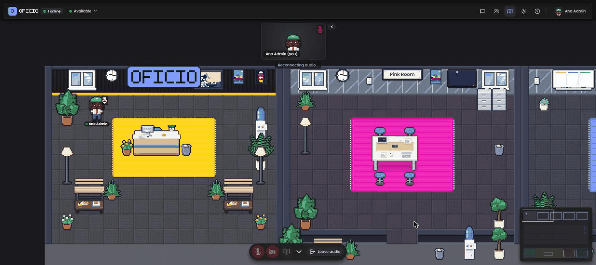

<p align="center">
  
</p>

<p align="center">
  <strong>Open source, self-hosted virtual office.</strong><br>
  A shared pixel-art map where your team moves around, talks by proximity, sits at desks and meets in rooms.
</p>

<p align="center">
  <a href="https://github.com/thiagomorello/oficio/actions/workflows/ci.yml"></a>
  <a href="https://github.com/thiagomorello/oficio/releases"></a>
  <a href="https://github.com/thiagomorello/oficio/pkgs/container/oficio"></a>
  <a href="LICENSE"></a>
</p>

<p align="center">
  <a href="README.pt-BR.md">Português (Brasil)</a>
</p>

---

Oficio gives a remote team a place that feels like an office: you see who is around, walk up to someone to talk,
knock on a meeting-room door, claim a desk and decorate it. Everything runs on your own server, with your own
name, logo and colors.

<p align="center">
  
</p>

## Features

- **Shared map in real time.** Server-authoritative simulation at 20 Hz over WebSocket; smooth movement, status
  (available / busy / away), names over avatars, minimap.
- **Proximity audio and video.** Powered by [LiveKit](https://livekit.io): you hear and see the people near you,
  meeting rooms are private, screen sharing included. Self-host the SFU with one container or use LiveKit Cloud.
- **Meeting rooms with doors.** Rooms can be locked; knock to ask to come in. Seats per room, occupancy on the map.
- **Desks.** Claim a desk, decorate it (plants, mugs, books, trophies...), see who sits where.
- **Chat with scopes.** Everyone, current room, or people nearby. History kept in the database.
- **Avatar editor.** Hair, skin, outfit, accessories, badge; presets and a randomizer.
- **Admin panel.** Invite and manage users, reset passwords, see who is online, telemetry dashboard.
- **Map editor.** Draw your own office in the browser: floors, walls, furniture, rooms, desks; versions and publishing.
- **Whitelabel.** Name, logo, accent color and the sign in the lobby come from environment variables.
- **Three languages.** English, Brazilian Portuguese and Spanish; each person can pick theirs. Adding a language is a PR.
- **Operations-friendly.** Health endpoint, Prometheus metrics, additive migrations, single stateless-ish container,
  multi-arch image (amd64/arm64).

## Try it in one command

```sh
docker run --rm -p 4747:4747 -e OFFICE_IN_MEMORY=1 -e OFFICE_COOKIE_SECURE=0 ghcr.io/thiagomorello/oficio
```

Open `http://localhost:4747` and sign in as `dev@oficio.local` / `dev12345`. This demo keeps everything in memory
(nothing survives a restart) and has no audio/video because there is no LiveKit; it is only for a first look.

## Quick start (any Linux VPS with Docker)

You need a server with a public IP, Docker 24+ with Compose v2, and two DNS records pointing to it
(for example `office.example.com` and `livekit.example.com`). Full requirements: [docs/requirements.md](docs/requirements.md).

```sh
git clone https://github.com/thiagomorello/oficio.git && cd oficio
cp .env.example .env
./scripts/gen-secrets.sh                 # fills every secret in .env
nano .env                                # set OFFICE_DOMAIN, LIVEKIT_DOMAIN, ACME_EMAIL (and LIVEKIT_NODE_IP = your public IP)
docker compose up -d                     # app + MySQL + LiveKit + Caddy (automatic HTTPS)
./scripts/first-admin.sh you@example.com "Your Name"
```

Open `https://office.example.com`, sign in with the temporary password printed by the last command, build your
avatar and walk in. Step-by-step with screenshots: [docs/quickstart.md](docs/quickstart.md).

## Deploy with an AI coding agent

Oficio ships with an [AGENTS.md](AGENTS.md) runbook written for coding agents (Claude Code, Codex, Cursor and
similar). It tells the agent what to ask you first, which guide to follow for each platform, the exact commands,
the checks after each step and the guardrails (never commit `.env`, never demo mode in production, exactly one app
replica, pin the image version). Claude Code picks it up automatically through [CLAUDE.md](CLAUDE.md); Codex reads
`AGENTS.md` natively.

Open your agent on the server (or on a machine with SSH access to it) and paste something like:

```text
Deploy Oficio (https://github.com/thiagomorello/oficio) to production on this server following AGENTS.md.
Domains: office.example.com and livekit.example.com (DNS already points here). ACME e-mail: you@example.com.
Public IP: run `curl -4 ifconfig.me`. App name "Acme Office", accent color #ff6600, default language en.
First admin: you@example.com, "Your Name". Use the self-hosted LiveKit from docker-compose.yml.
Pin release v0.1.0. Stop and ask me before any destructive command, and give me the temporary admin password only once.
```

The same runbook covers Portainer, Coolify, Dokploy, Railway, Render, Fly.io and Kubernetes by pointing the agent
at the right guide in [docs/deploy/](docs/deploy/). The agent needs shell access to the target (SSH or the
platform's CLI); it cannot open ports or create DNS records for you unless you give it those credentials.

## Install guides

| Where | Guide |
|---|---|
| Any VPS with Docker Compose (Hetzner, OVH, Contabo, Linode, Vultr...) | [docs/deploy/docker-compose-vps.md](docs/deploy/docker-compose-vps.md) |
| Hostinger VPS | [docs/deploy/hostinger.md](docs/deploy/hostinger.md) |
| DigitalOcean (Droplet or App Platform) | [docs/deploy/digitalocean.md](docs/deploy/digitalocean.md) |
| Portainer (standalone or Swarm + Traefik) | [docs/deploy/portainer.md](docs/deploy/portainer.md) |
| Coolify / Dokploy | [docs/deploy/coolify.md](docs/deploy/coolify.md) · [docs/deploy/dokploy.md](docs/deploy/dokploy.md) |
| Railway | [docs/deploy/railway.md](docs/deploy/railway.md) |
| Render | [docs/deploy/render.md](docs/deploy/render.md) |
| Fly.io | [docs/deploy/fly.md](docs/deploy/fly.md) |
| Vercel | [docs/deploy/vercel.md](docs/deploy/vercel.md) (why it does not fit, and what to use instead) |
| Kubernetes (Helm chart) | [docs/deploy/kubernetes.md](docs/deploy/kubernetes.md) · chart in [deploy/helm/oficio](deploy/helm/oficio) |
| LiveKit Cloud instead of self-hosted audio/video | [docs/deploy/livekit-cloud.md](docs/deploy/livekit-cloud.md) |

## Documentation

- [Requirements](docs/requirements.md) — hardware sizing, ports, DNS, browsers.
- [Configuration](docs/configuration.md) — every environment variable, branding, languages.
- [Architecture](docs/architecture.md) — how the pieces talk to each other and why there is one app replica.
- [Admin guide](docs/admin-guide.md) — users, map editor, telemetry, CLI.
- [LiveKit](docs/livekit.md) — self-hosted vs cloud, ports, TURN, testing a connection.
- [Database](docs/database.md) — bundled MySQL vs managed services.
- [Reverse proxy and TLS](docs/reverse-proxy.md) — Caddy, Traefik, nginx, Cloudflare.
- [Backup and restore](docs/backup-restore.md) · [Upgrading](docs/upgrading.md) · [Troubleshooting](docs/troubleshooting.md)
- [i18n](docs/i18n.md) · [Roadmap](docs/roadmap.md)

## Development

```sh
npm install
npm run dev        # http://127.0.0.1:4747 — in-memory data, user dev@oficio.local / dev12345
npm run typecheck && npm test
```

MySQL and LiveKit for local development: `docker compose -f docker-compose.dev.yml up -d` (see
[CONTRIBUTING.md](CONTRIBUTING.md)).

## Tech

Node 22 · TypeScript · Vite · plain DOM and canvas (no UI framework) · WebSocket (`ws`) · MySQL 8 · LiveKit · zod · Vitest.

## License and credits

MIT. Oficio started as a fork of [Habblaud](https://github.com/marmottajr/habblaud) by Márcio Junior, whose
procedural pixel-art engine is the heart of the map. See [CREDITS.md](CREDITS.md).
