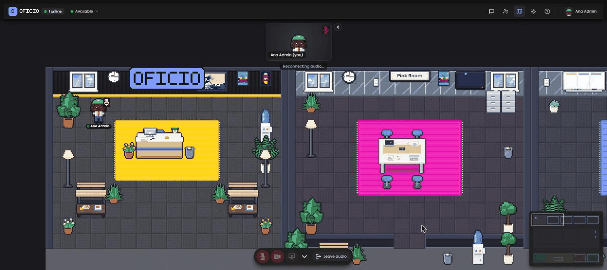

<p align="center">
  
</p>

<p align="center">
  <strong>Escritório virtual open source e auto-hospedado.</strong><br>
  Um mapa compartilhado em pixel art onde a sua equipe circula, conversa por proximidade, senta em mesas e se reúne em salas.
</p>

<p align="center">
  <a href="https://github.com/thiagomorello/oficio/actions/workflows/ci.yml"></a>
  <a href="https://github.com/thiagomorello/oficio/releases"></a>
  <a href="https://github.com/thiagomorello/oficio/pkgs/container/oficio"></a>
  <a href="LICENSE"></a>
</p>

<p align="center">
  <a href="README.md">English</a>
</p>

---

O Oficio dá a uma equipe remota um lugar que parece um escritório: você vê quem está por perto, caminha até alguém para conversar,
bate na porta de uma sala de reunião, reivindica uma mesa e a decora. Tudo roda no seu próprio servidor, com o seu próprio
nome, logo e cores.

<p align="center">
  
</p>

## Recursos

- **Mapa compartilhado em tempo real.** Simulação autoritativa no servidor a 20 Hz por WebSocket; movimento suave, status
  (disponível / ocupado / ausente), nomes sobre os avatares, minimapa.
- **Áudio e vídeo por proximidade.** Com [LiveKit](https://livekit.io): você ouve e vê as pessoas perto de você,
  salas de reunião são privadas, compartilhamento de tela incluído. Hospede o SFU você mesmo com um container ou use o LiveKit Cloud.
- **Salas de reunião com portas.** As salas podem ser trancadas; bata na porta para pedir para entrar. Assentos por sala, ocupação no mapa.
- **Mesas.** Reivindique uma mesa, decore-a (plantas, canecas, livros, troféus...), veja quem senta onde.
- **Chat com escopos.** Todo mundo, a sala atual ou as pessoas próximas. Histórico guardado no banco de dados.
- **Editor de avatar.** Cabelo, pele, roupa, acessórios, crachá; presets e um aleatorizador.
- **Painel de administração.** Convide e gerencie usuários, redefina senhas, veja quem está online, painel de telemetria.
- **Login único (OIDC).** Entre com Google Workspace, Microsoft Entra ID, Keycloak, Authentik ou qualquer provedor OpenID
  Connect, ao lado das contas de e-mail/senha; contas são criadas ou vinculadas no primeiro login, admins podem vir de uma claim de grupo.
- **Editor de mapa.** Desenhe o seu próprio escritório no navegador: pisos, paredes, móveis, salas, mesas; versões e publicação.
- **Whitelabel.** Nome, logo, cor de destaque e a placa da recepção vêm de variáveis de ambiente.
- **Três idiomas.** Inglês, português do Brasil e espanhol; cada pessoa escolhe o seu. Adicionar um idioma é um PR.
- **Amigável para operação.** Endpoint de health, métricas Prometheus, migrations aditivas, um único container quase stateless,
  imagem multi-arch (amd64/arm64).

## Experimente com um comando

```sh
docker run --rm -p 4747:4747 -e OFFICE_IN_MEMORY=1 -e OFFICE_COOKIE_SECURE=0 ghcr.io/thiagomorello/oficio
```

Abra `http://localhost:4747` e entre como `dev@oficio.local` / `dev12345`. Esta demonstração mantém tudo em memória
(nada sobrevive a um restart) e não tem áudio/vídeo porque não há LiveKit; serve só para uma primeira olhada.

## Início rápido (qualquer VPS Linux com Docker)

Você precisa de um servidor com IP público, Docker 24+ com Compose v2 e dois registros DNS apontando para ele
(por exemplo `office.example.com` e `livekit.example.com`). Requisitos completos: [docs/pt-BR/requirements.md](docs/pt-BR/requirements.md).

```sh
git clone https://github.com/thiagomorello/oficio.git && cd oficio
cp .env.example .env
./scripts/gen-secrets.sh                 # fills every secret in .env
nano .env                                # set OFFICE_DOMAIN, LIVEKIT_DOMAIN, ACME_EMAIL (and LIVEKIT_NODE_IP = your public IP)
docker compose up -d                     # app + MySQL + LiveKit + Caddy (automatic HTTPS)
./scripts/first-admin.sh you@example.com "Your Name"
```

Abra `https://office.example.com`, entre com a senha temporária impressa pelo último comando, monte o seu
avatar e entre no escritório. Passo a passo com capturas de tela: [docs/pt-BR/quickstart.md](docs/pt-BR/quickstart.md).

## Deploy com um agente de IA

O Oficio traz um runbook em [AGENTS.md](AGENTS.md) escrito para agentes de código (Claude Code, Codex, Cursor e
similares). Ele diz ao agente o que perguntar a você antes de começar, qual guia seguir em cada plataforma, os
comandos exatos, as verificações após cada passo e as regras de segurança (nunca commitar `.env`, nunca modo demo em
produção, exatamente uma réplica do app, fixar a versão da imagem). O Claude Code lê o arquivo automaticamente via
[CLAUDE.md](CLAUDE.md); o Codex lê `AGENTS.md` nativamente.

Abra o agente no servidor (ou numa máquina com acesso SSH a ele) e cole algo como:

```text
Faça o deploy do Oficio (https://github.com/thiagomorello/oficio) em produção neste servidor seguindo o AGENTS.md.
Domínios: office.example.com e livekit.example.com (o DNS já aponta para aqui). E-mail ACME: voce@example.com.
IP público: rode `curl -4 ifconfig.me`. Nome do app "Acme Office", cor de destaque #ff6600, idioma padrão pt-BR.
Primeiro admin: voce@example.com, "Seu Nome". Use o LiveKit auto-hospedado do docker-compose.yml.
Fixe a release v0.1.0. Pare e me pergunte antes de qualquer comando destrutivo e me entregue a senha temporária do admin só uma vez.
```

O mesmo runbook cobre Portainer, Coolify, Dokploy, Railway, Render, Fly.io e Kubernetes apontando o agente para o
guia certo em [docs/pt-BR/deploy/](docs/pt-BR/deploy/). O agente precisa de acesso ao shell do destino (SSH ou a CLI
da plataforma); ele não consegue abrir portas nem criar registros DNS por você a menos que receba essas credenciais.

## Guias de instalação

| Onde | Guia |
|---|---|
| Qualquer VPS com Docker Compose (Hetzner, OVH, Contabo, Linode, Vultr...) | [docs/pt-BR/deploy/docker-compose-vps.md](docs/pt-BR/deploy/docker-compose-vps.md) |
| VPS da Hostinger | [docs/pt-BR/deploy/hostinger.md](docs/pt-BR/deploy/hostinger.md) |
| DigitalOcean (Droplet ou App Platform) | [docs/pt-BR/deploy/digitalocean.md](docs/pt-BR/deploy/digitalocean.md) |
| Portainer (standalone ou Swarm + Traefik) | [docs/pt-BR/deploy/portainer.md](docs/pt-BR/deploy/portainer.md) |
| Coolify / Dokploy | [docs/pt-BR/deploy/coolify.md](docs/pt-BR/deploy/coolify.md) · [docs/pt-BR/deploy/dokploy.md](docs/pt-BR/deploy/dokploy.md) |
| Railway | [docs/pt-BR/deploy/railway.md](docs/pt-BR/deploy/railway.md) |
| Render | [docs/pt-BR/deploy/render.md](docs/pt-BR/deploy/render.md) |
| Fly.io | [docs/pt-BR/deploy/fly.md](docs/pt-BR/deploy/fly.md) |
| Vercel | [docs/pt-BR/deploy/vercel.md](docs/pt-BR/deploy/vercel.md) (por que não se encaixa, e o que usar no lugar) |
| Kubernetes | [docs/pt-BR/deploy/kubernetes.md](docs/pt-BR/deploy/kubernetes.md) |
| LiveKit Cloud em vez de áudio/vídeo auto-hospedado | [docs/pt-BR/deploy/livekit-cloud.md](docs/pt-BR/deploy/livekit-cloud.md) |

## Documentação

- [Requisitos](docs/pt-BR/requirements.md) — dimensionamento de hardware, portas, DNS, navegadores.
- [Configuração](docs/pt-BR/configuration.md) — todas as variáveis de ambiente, marca, idiomas.
- [Arquitetura](docs/pt-BR/architecture.md) — como as peças conversam entre si e por que há uma única réplica do app.
- [Guia do administrador](docs/pt-BR/admin-guide.md) — usuários, editor de mapa, telemetria, CLI.
- [Login único](docs/pt-BR/sso.md) — OpenID Connect com Google Workspace, Entra ID, Keycloak, Authentik; vínculo de contas, mapeamento de admin.
- [LiveKit](docs/pt-BR/livekit.md) — auto-hospedado vs cloud, portas, TURN, testando uma conexão.
- [Banco de dados](docs/pt-BR/database.md) — MySQL incluído vs serviços gerenciados.
- [Proxy reverso e TLS](docs/pt-BR/reverse-proxy.md) — Caddy, Traefik, nginx, Cloudflare.
- [Backup e restauração](docs/pt-BR/backup-restore.md) · [Atualização](docs/pt-BR/upgrading.md) · [Solução de problemas](docs/pt-BR/troubleshooting.md)
- [i18n](docs/pt-BR/i18n.md) · [Roadmap](docs/pt-BR/roadmap.md)

## Desenvolvimento

```sh
npm install
npm run dev        # http://127.0.0.1:4747 — in-memory data, user dev@oficio.local / dev12345
npm run typecheck && npm test
```

MySQL e LiveKit para desenvolvimento local: `docker compose -f docker-compose.dev.yml up -d` (veja
[CONTRIBUTING.md](CONTRIBUTING.md)).

## Tecnologia

Node 22 · TypeScript · Vite · DOM e canvas puros (sem framework de UI) · WebSocket (`ws`) · MySQL 8 · LiveKit · zod · Vitest.

## Licença e créditos

MIT. O Oficio começou como um fork do [Habblaud](https://github.com/marmottajr/habblaud), de Márcio Junior, cujo
motor procedural de pixel art é o coração do mapa. Veja [CREDITS.md](CREDITS.md).
