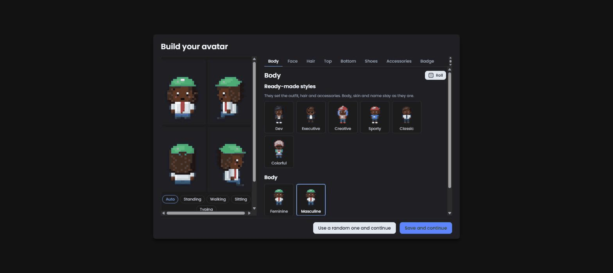
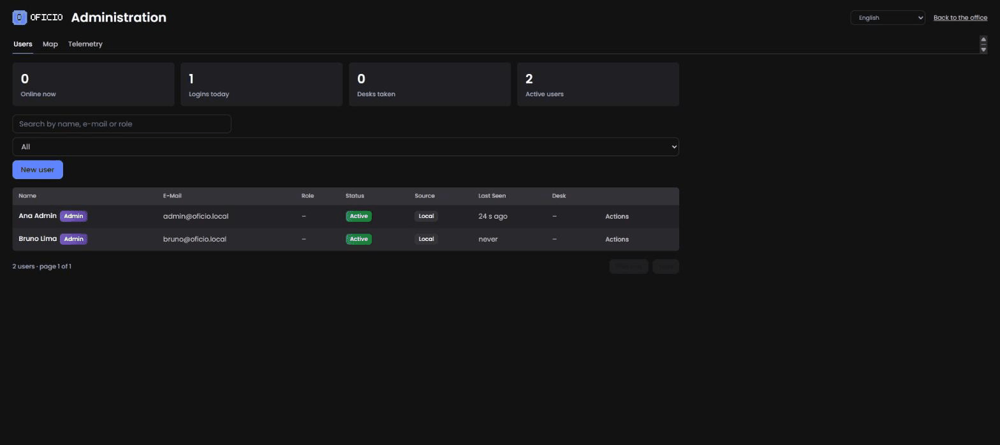
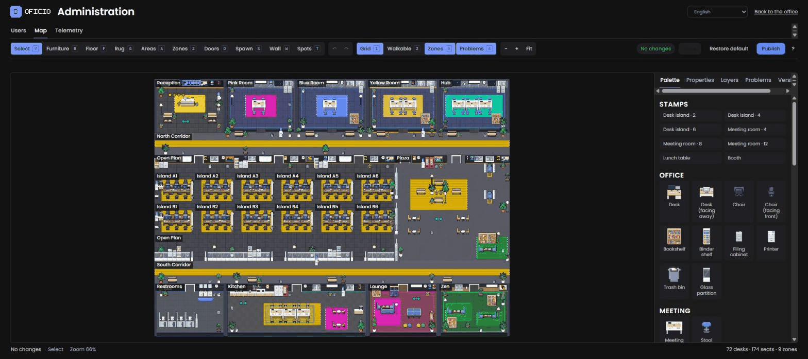

# Admin guide

Day-to-day operation of an Oficio instance: the first login, managing users (invite, disable, promote, reset passwords), drawing and publishing floor plans in the map editor, reading the telemetry dashboard, the command-line tools, and bulk-importing users from a JSON file. Everything here needs an account with the administrator flag; non-admins who open `/admin` see a "restricted" page.

## Pages

| URL | What it is | Who can open it |
|---|---|---|
| `/` | the office | any signed-in user |
| `/login` | sign in, forgot password, reset via e-mailed link, forced change of a temporary password | everyone |
| `/admin` | users and statistics | admins |
| `/admin/mapa` | map editor | admins |
| `/admin/telemetria` | telemetry dashboard | admins |

Non-admins who try `/admin*` get a `403` page with a link back to the office. Users with a pending temporary password are sent to `/login?change=1` until they set a new one.

## First login

After `./scripts/first-admin.sh you@example.com "Your Name"` (see [Quickstart](quickstart.md)), sign in with the temporary password. You are forced to choose a new one (8+ characters, not equal to your e-mail), then the **avatar editor** opens.



Pick a display name (shown over your head; it can differ from the account name), skin, hair, outfit, accessories and badge, or use the randomizer and the presets. Everyone goes through this screen once; it can be reopened later with **My avatar** in the office.

The office opens in the lobby of the **default map**: a reception with the brand sign, an open plan with desk islands, meeting rooms with doors, a kitchen, a lounge and a quiet room. You can use it as is, or redraw it (see [Map editor](#map-editor)).

## Users



The **Users** tab lists every account with: name, e-mail, role label, admin flag, status (active/disabled), source (`local` = created here, `imported` = came from `import-json`), last seen, whether an avatar has been created, the desk they claimed, and whether a password change is pending. Search by name or e-mail and filter by status. The cards at the top show people online right now, logins today, desks claimed and active accounts.

### Invite a user

**Invite** asks for name, e-mail, an optional free-text **role** (e.g. "Design", "Support"; existing labels are suggested) and the **Administrator** checkbox. The server creates the account with a random temporary password and `must_change_password` set, then:

- with SendGrid configured (`SENDGRID_API_KEY` + `MAIL_FROM`), e-mails an invitation in the language of your admin session, containing the temporary password and a link to `/login`;
- without it, shows the temporary password **once** in the dialog. Copy it and hand it over through a channel you trust.

Either way the person must set their own password at first login. E-mails are unique; inviting an existing address answers "e-mail already in use".

### Disable, enable, promote, demote

Open a user row to change **status** (`active`/`disabled`), the **admin** flag, the **role** label or the **name**. Rules enforced by the server:

- You cannot disable yourself or remove your own admin flag.
- The last active administrator cannot be disabled or demoted ("last admin").
- Disabling a user signs them out immediately: their session cache is dropped and, if they are in the office, they are kicked (`kick {reason: "disabled"}`). A disabled account cannot log in or use a password-reset link until re-enabled.
- Promoting or demoting also invalidates the person's cached session so the new rights apply on their next request.

### Reset a password

**Reset password** generates a new temporary password with forced change at next login and invalidates the current session. It is e-mailed in the **user's own saved language** when SendGrid is configured; otherwise it is shown to you once. Users can also help themselves through **Forgot password** on the login page, which e-mails a one-hour, single-use reset link (`/login?reset=…`); without a mailer that form tells them to contact an administrator.

### Release a desk

If someone claimed a desk and left the company, or you need the desk back, use **Release desk** on their row. The desk becomes free immediately for everyone online.

## Map editor



`/admin/mapa` is a browser editor for the floor plan. Concepts:

- **Tiles.** The map is a grid (the default map is 80×58 tiles). Each tile has a floor, may have walls, furniture or a rug, and belongs to at most one zone.
- **Areas** group tiles into named spaces (reception, open plan, corridor…); **zones** are the subset that behaves as rooms: meeting rooms (private, lockable, with doors you knock on), lounges, quiet rooms. A zone needs at least one **doorway**.
- **Spots** are interactive tiles: **seats** (chairs; a seat next to a desk makes a claimable **desk**), and usable objects (coffee machine, sink, arcade…).
- **Spawn points** are where people appear when they connect or when their previous tile disappears.
- **Wall items** sit on walls: signs, pictures, whiteboards. A sign whose label is the special text `{brand}` renders your logo/sign text (`OFFICE_SIGN_TEXT`); the reception sign of the default map uses it.

### Tools and panels

Tools: **select** (move, resize, delete), **floor**, **area**, **zone**, **doorway**, **place** (furniture), **rug**, **spot** (seats and usables), **wall item**, **spawn**, each with a keyboard shortcut. Panels: **layers** (show/hide floors, walls, furniture, zones…), **palette** (floor and wall styles, furniture catalog, room tints, signs), **properties** of the selected element, **problems** (validation results), and **versions**.

### Draft, validate, publish

There is **one shared draft** per instance. Edits autosave to the server; if another admin saved in between, your save is refused with a conflict message and you reload their draft. Nobody in the office sees the draft.

**Validate** runs the same checks the server runs before publishing and lists them in the problems panel, each with a position you can click to jump to. **Errors** block publishing: furniture outside the map or overlapping, seats on walls, wall items off a wall, doorways not on a wall or blocked, missing/blocked/unreachable spawn points, unreachable or blocked spots, empty or overlapping zones, zones without a door, invalid sign references. **Warnings** need confirmation: missing or very dark floors, overlapping or hidden wall items, unreachable tiles, zones with many doors or over capacity, desks without chairs, chairs without desks, mismatched desk pairs. Validation also previews how many people would be moved and how many seats and desks would be released by publishing.

**Publish** turns the draft into an immutable **version** (named "Version N" by default, or a name you type), marks it as the published map, removes from the database any desk claim whose desk no longer exists, and **swaps the live map** without a restart: everyone online receives the new layout, people standing on removed tiles are moved to the nearest free tile or a spawn point, and seats or desks that vanished are released. The office keeps running during the swap.

### Versions and rollback

The **versions** panel lists every published version with its author, date and stats (desks, seats, zones, warnings). From there you can:

- **Restore to draft** a version, to continue editing from it.
- **Republish** an older version directly: that is your rollback.
- **Delete** a version, except the one currently published and the last remaining one.
- **Restore the default map** into the draft (overwrites the draft with the built-in layout, in the instance language).

The default map is stored as version #1 on the first boot of a fresh database, so a rollback target always exists.

### Tips

- Publish during a quiet hour on large changes; relocation is instantaneous but surprising.
- Keep at least two spawn tiles so people connecting at the same moment do not pile up.
- Meeting rooms with a single doorway behave best for knocking and locking.
- Big maps are fine for the renderer; what costs performance is the number of people on camera, not tiles.

## Telemetry

`/admin/telemetria` shows diagnostic data that the client and server record to help you spot connectivity and performance problems. It contains no chat content.

- **Summary per user** over a window (`24h` by default; `7d`, `90m`… up to the 14-day retention): sessions, samples, average and p95 round-trip time, average FPS, rejected moves, position jumps, disconnects, errors, last audio/video status, and whether the person is online now.
- **Events**, filterable by user, kind, session id and window. Client kinds: `session_start`, `sample`, `socket`, `kick`, `moved_reject`, `pos_jump`, `av_status`, `av_error`, `js_error`, `visibility`, `map_fallback`, `avatar_editor_error`. Server kinds (session `server`): `moved_reject`, `kick`, `ws_connect`, `ws_disconnect`, `ws_drop`.

Clients post batches to `POST /api/telemetry` (at most 100 items of 4 KB each, rate-limited per user). Events older than 14 days are purged every hour. Typical reads: a person who "lags" shows high RTT or many `pos_jump`s (bad network); `av_error` entries point at microphone permissions or a blocked UDP port; many `ws_drop`s for everyone at the same minute point at a proxy timeout or a restart.

For infrastructure-level numbers use `GET /metrics` (Prometheus) and `GET /api/health`; see [Configuration → Observability](configuration.md#observability-optional).

## Command-line tools

The CLI talks directly to the database (`DATABASE_URL` or the `MYSQL_*` parts) and does not need the web server running.

Inside the compose stack:

```sh
docker compose exec app node dist/server/cli.js <command> [options]
```

From a source checkout:

```sh
npm run cli -- <command> [options]
```

| Command | What it does |
|---|---|
| `migrate` | Apply pending database migrations (the server also does this at boot; useful before starting a new version or for a CI check). |
| `create-admin --email <e> --name <n> [--password <p>]` | Create an administrator. Without `--password`, prints a temporary password once and forces a change at first login. If the e-mail exists, the account is promoted to admin and re-activated; its password is left alone. Passwords must have 8+ characters. |
| `reset-password --email <e>` | Set a new temporary password (printed once, forced change) for any account. Exit code 1 when the user does not exist. |
| `import-json <file> [--dry-run] [--adopt-local]` | Bulk import or update users from a JSON array. See below. |

`scripts/first-admin.sh <email> <name> [password]` is a thin wrapper around `create-admin` for the compose stack. Exit codes: `0` success, `1` failure (logged), `2` usage error (the usage text is printed).

## Importing users with `import-json`

Use this to onboard a whole team at once or to sync accounts from another system. The file is a **JSON array of objects**; the reader accepts the field names in snake_case or camelCase:

| Field | Required | Notes |
|---|---|---|
| `external_id` (or `externalId`, `id`) | yes | Stable identifier from the source system, up to 64 characters. Used to match rows on later imports. |
| `email` | yes | Lower-cased and trimmed; must be a valid address (max 190 chars). |
| `name` | yes | Full name (max 190 chars). |
| `password_hash` (or `passwordHash`) | one of the two | A **bcrypt** hash (`$2a$`, `$2b$`, `$2x$` or `$2y$`; PHP's `$2y$` is normalised). |
| `password` | one of the two | A plain password of **at least 8 characters**; it is hashed with bcrypt during import and never stored in clear. Shorter passwords leave the row without a valid hash and it is skipped. Ignored when a hash is present. |
| `role_name` (or `roleName`, `role`) | no | Free-text label (max 120 chars). Empty means none. |
| `is_admin` (or `isAdmin`) | no | `true`, `1`, `"1"` or `"true"` make the account an administrator. |

Example `team.json`:

```json
[
  { "external_id": "hr-1042", "email": "ana@example.com", "name": "Ana Souza", "password": "first-day-2026!", "role": "Design" },
  { "external_id": "hr-1043", "email": "bruno@example.com", "name": "Bruno Lima",
    "password_hash": "$2y$10$Gq3o2E1Y0b4mYQp1Jk7Hn.G5XJ1b0YtLx9S5C1mNfYbQxZ3cH4e6S", "is_admin": true },
  { "externalId": "hr-1044", "email": "carla@example.com", "name": "Carla Reis", "passwordHash": "$2b$10$...", "roleName": "Support" }
]
```

What happens to each row:

| Situation | Action |
|---|---|
| Invalid row (missing id, bad e-mail, empty name, no valid bcrypt hash) | `skipped` with the reason |
| Same `external_id` or e-mail appears twice in the file | second occurrence `skipped` ("duplicate in file") |
| `external_id` already exists | `updated`: name, password hash and role are refreshed; the admin flag is only ever **raised** by an import (an import never demotes someone); the e-mail on file is **not** changed |
| E-mail exists on an account with a **different** `external_id` | `skipped` (conflict reported) |
| E-mail exists on a **local** account (created by invite or `create-admin`) | `skipped`, unless `--adopt-local`, which links that account to the `external_id` (`adopted`) |
| Otherwise | `inserted` |

The report is a table `action / email / note` followed by totals; hashes are never printed.

### Recommended workflow

1. Copy the file into the container (or use a bind mount) and **always dry-run first**:

   ```sh
   docker compose cp team.json app:/tmp/team.json
   docker compose exec app node dist/server/cli.js import-json /tmp/team.json --dry-run
   ```

   `--dry-run` performs every check and prints the same report, but writes nothing.
2. Read the `skipped` lines. Fix the file, or decide whether `--adopt-local` is what you want for e-mails that already exist as local accounts.
3. Run for real:

   ```sh
   docker compose exec app node dist/server/cli.js import-json /tmp/team.json --adopt-local
   ```

4. Re-running the same file is safe: existing `external_id`s are updated, nothing is duplicated. That makes a nightly sync from an HR export a reasonable setup.
5. Remove the file from `/tmp` afterwards if it contained plain passwords (`docker compose exec app rm /tmp/team.json`; `/tmp` is a tmpfs and is also cleared on restart).

Imported users appear with source `imported` in the admin list. Their first login uses the password you imported; they are **not** forced to change it unless you reset it.

## Routine checklist

- Weekly: glance at `/admin/telemetria` for recurring `av_error`/`ws_drop` patterns; check `docker compose ps` is all healthy.
- After each invite wave: confirm nobody is stuck with a pending password change (column in the users list).
- Monthly: verify a backup restores (see [Backup and restore](backup-restore.md)); read the [changelog](../CHANGELOG.md) and plan an [upgrade](upgrading.md).
