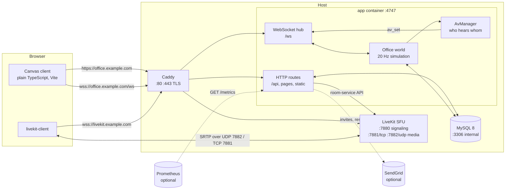

# Architecture

Oficio is a single Node.js process that serves the browser client, owns the authoritative state of the office and pushes it to everyone over WebSocket, next to a MySQL database for durable data and a LiveKit SFU for audio and video. This page walks through the components and data flow, the lifecycle of an HTTP request, the WebSocket protocol, how LiveKit tokens and proximity subscriptions work, what is persisted, why there is exactly one app replica, the security posture, and the layout of the repository.

## Components



| Component | Role | Where in the repo |
|---|---|---|
| **Client** | Three Vite pages (`index.html` office, `login.html`, `admin.html`) in plain TypeScript, DOM built with a small `h()` helper, the map drawn on a canvas with procedurally generated pixel art. Talks to the server over `fetch` and one WebSocket, and to LiveKit through `livekit-client`. | `client/` |
| **HTTP layer** | Request guard, health, public config, auth, profile, admin, map, telemetry, metrics routes, page gate, static files (or Vite middleware in `--dev`). | `server/http/`, `server/app-factory.ts` |
| **WebSocket hub** | Accepts upgrades on `/ws`, authenticates with the session cookie, enforces heartbeat and rate limits, hands decoded messages to the world. | `server/ws/` |
| **Office world** | The authoritative simulation: positions, movement validation, seats, desks, zones (rooms) with locks and knocking, chat, status, media flags. Ticks at 20 Hz, broadcasts deltas at 10 Hz. | `server/world/` |
| **AvManager** | Computes, per person, who is audible and at what volume from positions and zones, and tells the client (`av_set`). | `server/world/av.ts`, `shared/map/zones.ts` |
| **LiveKit** | WebRTC SFU: every participant publishes mic/camera/screen once; the SFU forwards to subscribers. Self-hosted container or LiveKit Cloud. | `docker-compose.yml`, `deploy/livekit/` |
| **MySQL** | Users, tokens, desks, chat history, maps, settings, telemetry. Migrations applied by the app at boot. | `server/db/` |
| **Caddy** | TLS termination with automatic certificates, security headers, reverse proxy for the app and LiveKit signaling. Replaceable by Traefik/nginx; see [Reverse proxy](reverse-proxy.md). | `docker-compose.yml`, `deploy/caddy/` |
| **Shared** | Code compiled into both sides: WebSocket protocol and validation (zod), map model/assembly/validation, i18n dictionaries, branding helpers. | `shared/` |

## Boot sequence

1. `server/index.ts` loads the configuration from the environment (`loadConfig`) and logs every warning (missing secrets, invalid colour, …).
2. With `DATABASE_URL`, it opens a `mysql2` pool and **runs pending migrations** under a MySQL named lock (`GET_LOCK('office_migrate')`), recording each in `office_migrations`. Without a database in `--dev`, it uses in-memory repositories and creates `dev@oficio.local`.
3. `loadBootMap` reads the **published map** from `office_maps`. On the very first boot there is none, so the built-in default map is stored as version #1 and marked published.
4. `createApp` assembles the map into a walkable grid, starts the `Office` world, attaches the WebSocket hub to the HTTP server, wires the routes, and schedules the hourly telemetry purge (14-day retention).
5. The server listens on `OFFICE_HOST:OFFICE_PORT`. On `SIGTERM`/`SIGINT` it closes the hub, stops the world, closes the pool and exits (3 s hard limit), which is what `docker compose stop` relies on.

## Request lifecycle

Every HTTP request passes through the same pipeline in `app-factory.ts`:

1. **Language.** The request's locale is resolved once: `?lang=` → `Accept-Language` → `OFFICE_DEFAULT_LOCALE`. All error messages from this point are translated with it.
2. **Guard** (`server/http/guard.ts`).
   - The `Host` header must be a literal IP, `localhost`/`*.localhost`, or a name listed in `OFFICE_ALLOWED_HOSTS`; otherwise `403 Host not allowed`. This defeats DNS rebinding.
   - For anything that is not `GET`/`HEAD`/`OPTIONS`: when an `Origin` header is present it must match the `Host` or an allowed name (`403 Origin not allowed`), and requests under `/api/` must carry `Content-Type: application/json` (`415`). Because a cross-site form or a "simple" `fetch` cannot send a JSON content type without a CORS preflight, and the server never answers preflights, this is the CSRF defence. No CSRF tokens are needed.
3. **Unauthenticated endpoints**: `GET /api/health`, `GET /api/config`, `GET /manifest.webmanifest`, `GET /metrics` (bearer token when `METRICS_TOKEN` is set).
4. **`/api/*`**: if `OFFICE_JWT_SECRET` is missing the answer is `503 authentication not configured`. Otherwise the route handlers run in order: auth (`/api/auth/*`), profile (`/api/me*`), telemetry, admin (`/api/admin/*`), world (`/api/map`, `/api/livekit/token`), map editor (`/api/admin/maps*`). Unknown paths get `404`.
5. **Page gate** for `/`, `/index.html`, `/admin` and `/admin/*`: no valid session → `302 /login?next=…`; account flagged `must_change_password` → `302 /login?change=1`; `/admin*` for a non-admin → a small `403` HTML page.
6. **Static files** from `dist/client` (production) or Vite middleware (`--dev`). Hashed bundles under `/bundle/` are served with `Cache-Control: immutable` for a year; everything else with `no-cache` + ETag. Unknown paths fall back to `index.html`; `/login` and `/admin*` map to their own HTML pages. If `dist/client/index.html` does not exist, every page answers `503 Client not built`.

### Sessions

- Login (`POST /api/auth/login`) verifies the bcrypt hash (a constant dummy hash is compared when the e-mail does not exist, so timing does not reveal valid accounts), refuses disabled accounts with `403 {code: "disabled"}`, and sets the cookie **`office_session`**: a JWT (HS256, `OFFICE_JWT_SECRET`) valid for **30 days**, `HttpOnly`, `Secure` unless `OFFICE_COOKIE_SECURE=0`.
- The token carries the user id and `pv` (password version). Changing the password bumps `pv`, so older cookies stop working immediately. Admin actions (disable, demote, reset) also drop the in-memory session cache entry.
- A small LRU cache (500 entries, 5 minutes) avoids a database read on every request; connected users are periodically revalidated against the database.
- **Rate limits** (in-memory, sliding window, 10 attempts per 10 minutes): login failures per `IP|email`; `forgot` requests per IP (every request counts); password changes per user. Blocked callers get `429` with `Retry-After`. The client IP comes from `X-Forwarded-For` only when `TRUST_PROXY=1`.
- **Password reset**: `forgot` creates a random token, stores only its SHA-256 (`password_tokens`, kind `reset`, 1 hour, single-use) and e-mails `OFFICE_PUBLIC_URL/login?reset=<token>&lang=<locale>`. Without a mailer the endpoint answers `{ok: true, manual: true}` and the UI tells the person to ask an admin. Passwords must be at least 8 characters and different from the e-mail.
- **Single sign-on (OIDC)**: `GET /api/auth/oidc/start` stores `state`, `nonce` and the PKCE verifier in a signed 10-minute cookie (`office_oidc`) and redirects to the provider; `GET /api/auth/oidc/callback` validates them, exchanges the code with `openid-client`, finds the account by `external_id = oidc:<issuer>|<sub>` or links/creates it by e-mail, applies the admin claim mapping and issues the same `office_session` cookie. Provider metadata is discovered lazily and cached. Details in [Single sign-on](sso.md).

## WebSocket protocol

Defined in `shared/protocol.ts`: JSON, one object per frame, discriminated by the `t` field, validated on the server with zod (`PROTOCOL_VERSION = 1`). The client sends **intentions**; the server validates them and is the single source of truth.

**Connection** (`server/ws/hub.ts`): the upgrade on `/ws` requires an `Origin` matching the `Host` or `OFFICE_ALLOWED_HOSTS` and a valid session cookie; otherwise it is refused before the upgrade. Limits: frames up to 8 KiB, 30 messages per second per socket (excess → `error {code: "rate_limited"}` and close 1008), heartbeat every 20 s with two missed pongs dropping the connection. A second connection from the same user replaces the first (`kick {reason: "replaced"}`). The client reconnects automatically with exponential backoff (2 s doubling up to 30 s) and resyncs from the `welcome` snapshot.

**Client → server**

| Message | Meaning |
|---|---|
| `ping {ts}` | clock sync; answered by `pong {ts, now}` |
| `move_to {x,y,run?,seq?}` / `move_dir {dir,run?,seq?}` | path or direction intent, in tiles |
| `pos {x,y,dir,moving,run?}` | own position in world pixels, validated by the server (rejects with `moved_reject`) |
| `sit {spot}` / `use {spot}` / `stand` | seats and usable spots (coffee machine, arcade…) |
| `emote {emote}`, `status {status}`, `activity` | emotes, available/busy/away, "I am still here" (resets auto-away) |
| `chat {scope, text}` | `global`, `room` or `near`; text cleaned and capped at 1000 chars |
| `lock {zone, locked}`, `knock {zone}`, `admit {zone, user, allow}` | meeting-room doors |
| `desk_claim {desk}` / `desk_release` | desks |
| `media {mic, cam, screen, speaking?}` | local A/V state shown on the avatar |

**Server → client**

| Message | Meaning |
|---|---|
| `welcome` | full snapshot on connect: you, tick and clock, map `{id, version, etag}`, entities, users, zones, desks, recent chat, and `livekit {url, token, room}` (or `null` when LiveKit is not configured) |
| `state` | full resync (after a map publish) |
| `delta {tick, e[]}` | positions at 10 Hz as compact tuples `[id, x*16, y*16, dir+pose, flags, held]` |
| `join`, `leave`, `status`, `appearance`, `chat`, `zone`, `desk`, `map`, `knock`, `knock_result`, `media` | incremental events |
| `av_set {hear[], allow[], volumes{}, screenAllowed}` | who you should hear/see and at what volume (see below) |
| `ack {seq,x,y}`, `moved_reject {seq?, reason, x, y}` | movement reconciliation |
| `notice`, `kick {reason}`, `error {code}` | housekeeping |

## LiveKit token flow and proximity

1. The server mints LiveKit access tokens itself (`server/livekit/tokens.ts`) with `LIVEKIT_API_KEY`/`SECRET`: identity `u<userId>`, display name, **12-hour TTL**, grant `roomJoin` to the single room `LIVEKIT_ROOM`, `canPublish` and `canSubscribe` true, `canPublishData` false, publishable sources microphone, camera, screen share and screen-share audio. The browser never sees the API secret.
2. The token arrives in the `welcome` message and can be refreshed with `GET /api/livekit/token` (`503` when LiveKit is not configured).
3. The whole office is **one LiveKit room**. Privacy and bandwidth come from subscriptions, not from rooms: after every tick in which someone changed tile or zone, `AvManager` recomputes each person's audible set from the map geometry (distance in the open plan, same zone inside a meeting room, walls block sound) and sends `av_set` only when it changed, at most four times per second per person. Hearing is symmetric: the people you hear are exactly the people who can hear you.
4. The client (`client/src/av/subscriptions.ts`) reconciles the room against `av_set`: it subscribes to the tracks of the identities in `hear` and unsubscribes from the rest (so the SFU never forwards media you cannot hear), sets each participant's volume from `volumes`, and calls `setTrackSubscriptionPermissions` with `allow` so the SFU **refuses** to deliver your tracks to anyone outside your audible set. Screen-share tracks follow `screenAllowed`.
5. `server/livekit/control.ts` can additionally update a participant's publish permissions through the LiveKit room-service API (`LIVEKIT_INTERNAL_URL`), debounced to 400 ms per user.

Media packets never touch the Oficio server: they flow between browsers and LiveKit over UDP 7882 (or TCP 7881 as fallback).

## Persistence

All tables are created by additive migrations in `server/db/migrations/` (`001_init` … `005_telemetry`), tracked in `office_migrations`:

| Table | Holds |
|---|---|
| `users` | accounts: e-mail, name, display name, bcrypt `password_hash`, `password_version`, `must_change_password`, `role_name`, `is_admin`, `status` (`active`/`disabled`), `external_id` (set for imported accounts), `appearance` and `settings` (JSON), `last_seen_at` |
| `password_tokens` | hashed reset/invite tokens with expiry and `used_at` |
| `desks` | which user owns which desk id, plus `decor` (JSON, migration 004) |
| `chat_messages` | chat history by scope (`global`/`room`/`near`) and zone |
| `sessions_log` | login sessions (opened/closed, IP) feeding the "logins today" counter |
| `office_maps` | map documents: the shared `draft` and immutable `version`s with `published_at`, parent, author and stats |
| `office_settings` | key/value settings, notably the id of the published map |
| `telemetry_events` | client and server diagnostic events, purged after 14 days |

Everything else (positions, who is in which room, locks, pending knocks, rate limiters, session cache) lives in memory and is rebuilt from the database and from reconnecting clients after a restart.

## Why exactly one replica

The office is a real-time simulation: positions, zone membership, locks and the audible sets of everyone online are held in the memory of one process and advanced 20 times per second. Two replicas would each believe they own the world, and a person connected to replica A would be invisible to someone on replica B. The in-memory rate limiters and session cache make the same assumption. Therefore:

- Run **one** `app` container (`replicas: 1`, `order: stop-first` in the Swarm stack). Scale **up** (more CPU/RAM), not out.
- Restarts and upgrades drop every WebSocket; clients reconnect automatically within seconds and receive a fresh `welcome`. Nobody has to log in again: sessions are cookies.
- MySQL and LiveKit are separate processes and can live on other hosts or be managed services.
- Sharing world state through Redis so that several replicas can cooperate is on the [roadmap](roadmap.md), not in 0.1.

## Security posture

- **Container**: non-root user `node`, `read_only` root filesystem (only `/tmp` as a 64 MB tmpfs), `cap_drop: [ALL]`, `no-new-privileges`, memory limit, log rotation. The app writes nothing to disk.
- **Edge**: Caddy adds `Strict-Transport-Security`, `X-Content-Type-Options: nosniff`, `X-Frame-Options: DENY`, `Referrer-Policy`. The app itself also sends `nosniff`, `X-Frame-Options: DENY` and `Referrer-Policy: no-referrer` on pages, and `Cross-Origin-Resource-Policy: same-origin` on the map document.
- **Authentication**: bcrypt (cost 10), HS256 session JWT with password-version invalidation, `HttpOnly`/`Secure` cookie, login/forgot/change rate limits, constant-time comparison for the metrics token, hashed single-use reset tokens.
- **Input**: every WebSocket frame and every JSON body is validated with zod schemas that are `strict()` (unknown fields rejected); chat text is stripped of control characters; message sizes and rates are capped.
- **Isolation**: MySQL is on an internal network only; LiveKit tokens are short-lived and minted server-side; metrics expose only aggregates.
- **Operator duties**: real `OFFICE_ALLOWED_HOSTS`, random secrets, HTTPS everywhere, `LOGIN_MASTER_PASSWORD` empty, ports 3306/4747/7880 never public. See [SECURITY.md](../SECURITY.md) for the full checklist and how to report a vulnerability.

## Repository layout

```
oficio/
├── client/                 browser app (Vite)
│   ├── index.html, login.html, admin.html
│   ├── public/assets/      pixel art, brand assets, fonts
│   └── src/
│       ├── art/            procedural pixel-art renderers
│       ├── av/             LiveKit integration, devices, proximity subscriptions
│       ├── editor/         map editor (tools, panels, draft store)
│       ├── net/            API client, WebSocket client, world store, branding
│       ├── pages/          login and admin pages, telemetry dashboard
│       ├── ui/             DOM helpers, settings, chat, shell
│       └── world/          office scene, input, camera
├── server/
│   ├── index.ts            entry point (config, migrations, boot map, listen)
│   ├── app-factory.ts      HTTP server, routes, page gate, hub wiring
│   ├── config.ts           environment → ServerConfig (+ warnings)
│   ├── cli.ts, cli-*.ts    CLI: migrate, import-json, create-admin, reset-password
│   ├── auth/               JWT, sessions, passwords, rate limiter, SendGrid mailer
│   ├── db/                 mysql2 pool, migrations, repositories, health
│   ├── http/               guard, routes (auth, me, admin, maps, telemetry, metrics), static
│   ├── import/             user import (JSON reader + pure core)
│   ├── livekit/            token minting, room-service control
│   ├── telemetry/          server sink and batch validation
│   ├── world/              Office simulation, AV manager, boot/fallback maps
│   └── ws/                 WebSocket hub and outbox
├── shared/                 protocol, model, map (doc, assembly, validation, default map), i18n, branding
├── deploy/                 Caddyfile, nginx conf, LiveKit yaml, Portainer stacks (standalone, Swarm+Traefik)
├── scripts/                gen-secrets, first-admin, backup/restore, brand asset generator, QA probes
├── docs/                   this documentation (+ docs/pt-BR mirror)
├── docker-compose.yml      production stack (app + MySQL + LiveKit + Caddy)
├── docker-compose.dev.yml  local MySQL + LiveKit for `npm run dev`
├── docker-compose.build.yml override to build the image from the checkout
└── Dockerfile              two-stage build, production deps only
```

Build: `npm run build` runs Vite for the client (`dist/client`) and esbuild for the server (`dist/server`, migrations bundled in). Tests: Vitest, next to the code (`*.test.ts`). Type checking covers both `tsconfig.json` (client/shared) and `server/tsconfig.json`.
