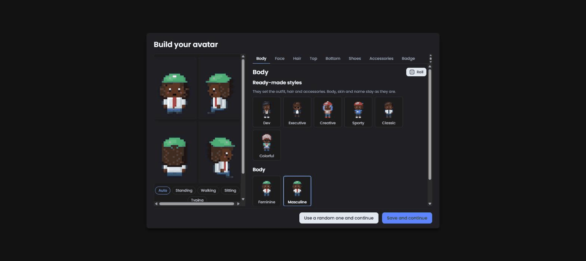
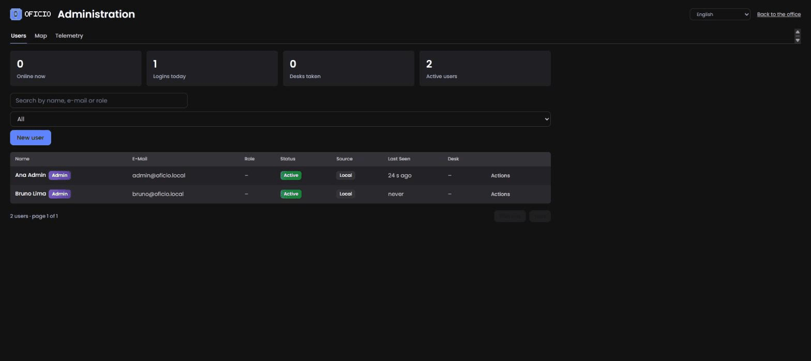
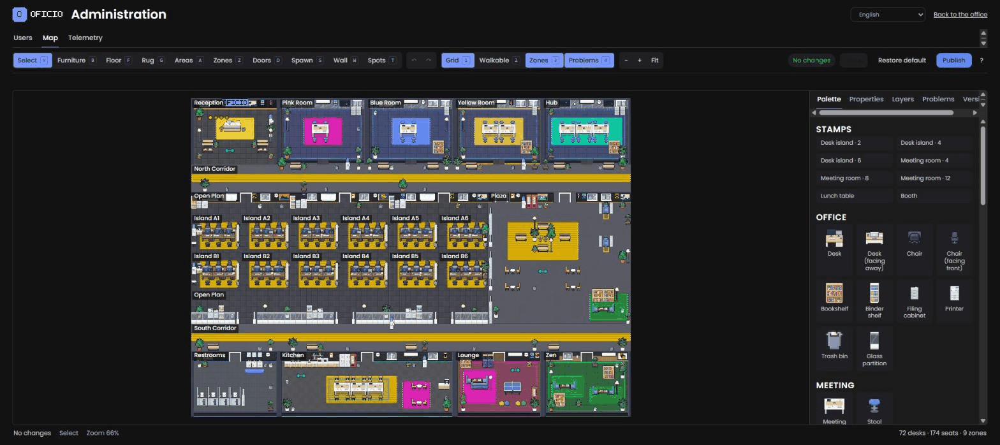

# Guia do administrador

Operação do dia a dia de uma instância do Oficio: o primeiro login, a gestão de usuários (convidar, desabilitar, promover, redefinir senhas), desenhar e publicar plantas no editor de mapa, ler o painel de telemetria, as ferramentas de linha de comando e a importação em massa de usuários a partir de um arquivo JSON. Tudo aqui exige uma conta com a flag de administrador; quem não é administrador e abre `/admin` vê uma página de "acesso restrito".

## Páginas

| URL | O que é | Quem pode abrir |
|---|---|---|
| `/` | o escritório | qualquer usuário autenticado |
| `/login` | entrar, esqueci minha senha, redefinição por link enviado por e-mail, troca forçada de uma senha temporária | todo mundo |
| `/admin` | usuários e estatísticas | administradores |
| `/admin/mapa` | editor de mapa | administradores |
| `/admin/telemetria` | painel de telemetria | administradores |

Quem não é administrador e tenta `/admin*` recebe uma página `403` com um link de volta ao escritório. Usuários com uma senha temporária pendente são enviados para `/login?change=1` até definirem uma nova.

## Primeiro login

Depois de `./scripts/first-admin.sh you@example.com "Your Name"` (veja [Início rápido](quickstart.md)), entre com a senha temporária. Você é obrigado a escolher uma nova (8+ caracteres, diferente do seu e-mail), e então o **editor de avatar** abre.



Escolha um nome de exibição (mostrado sobre a sua cabeça; pode ser diferente do nome da conta), pele, cabelo, roupa, acessórios e crachá, ou use o aleatorizador e os presets. Todo mundo passa por essa tela uma vez; ela pode ser reaberta depois em **Meu avatar** no escritório.

O escritório abre na recepção do **mapa padrão**: uma recepção com a placa da marca, um espaço aberto com ilhas de mesas, salas de reunião com portas, uma cozinha, um lounge e uma sala silenciosa. Você pode usá-lo como está, ou redesenhá-lo (veja [Editor de mapa](#editor-de-mapa)).

## Usuários



A aba **Usuários** lista todas as contas com: nome, e-mail, rótulo de função, flag de administrador, status (ativo/desabilitado), origem (`local` = criado aqui, `imported` = veio do `import-json`), última vez visto, se um avatar foi criado, a mesa que a pessoa reivindicou e se há uma troca de senha pendente. Pesquise por nome ou e-mail e filtre por status. Os cartões no topo mostram as pessoas online agora, logins hoje, mesas reivindicadas e contas ativas.

### Convidar um usuário

**Convidar** pede nome, e-mail, uma **função** opcional em texto livre (por exemplo "Design", "Suporte"; rótulos existentes são sugeridos) e a caixa **Administrador**. O servidor cria a conta com uma senha temporária aleatória e `must_change_password` definido, e então:

- com o SendGrid configurado (`SENDGRID_API_KEY` + `MAIL_FROM`), envia um e-mail de convite no idioma da sua sessão de administrador, contendo a senha temporária e um link para `/login`;
- sem ele, mostra a senha temporária **uma vez** no diálogo. Copie-a e entregue por um canal em que você confie.

De um jeito ou de outro, a pessoa precisa definir a própria senha no primeiro login. E-mails são únicos; convidar um endereço já existente responde "e-mail já em uso".

### Desabilitar, habilitar, promover, rebaixar

Abra a linha de um usuário para alterar o **status** (`active`/`disabled`), a flag de **administrador**, o rótulo de **função** ou o **nome**. Regras aplicadas pelo servidor:

- Você não pode desabilitar a si mesmo nem remover a própria flag de administrador.
- O último administrador ativo não pode ser desabilitado nem rebaixado ("último administrador").
- Desabilitar um usuário o desconecta imediatamente: seu cache de sessão é descartado e, se ele estiver no escritório, é expulso (`kick {reason: "disabled"}`). Uma conta desabilitada não consegue fazer login nem usar um link de redefinição de senha até ser reabilitada.
- Promover ou rebaixar também invalida a sessão em cache da pessoa, para que os novos direitos valham na próxima requisição.

### Redefinir uma senha

**Redefinir senha** gera uma nova senha temporária com troca forçada no próximo login e invalida a sessão atual. Ela é enviada por e-mail no **idioma salvo do próprio usuário** quando o SendGrid está configurado; caso contrário é mostrada a você uma vez. Os usuários também podem se ajudar sozinhos por **Esqueci minha senha** na página de login, que envia por e-mail um link de redefinição de uma hora e uso único (`/login?reset=…`); sem um mailer, esse formulário orienta a procurar um administrador.

### Liberar uma mesa

Se alguém reivindicou uma mesa e saiu da empresa, ou você precisa da mesa de volta, use **Liberar mesa** na linha da pessoa. A mesa fica livre imediatamente para todo mundo online.

## Editor de mapa



`/admin/mapa` é um editor da planta no navegador. Conceitos:

- **Tiles.** O mapa é uma grade (o mapa padrão tem 80×58 tiles). Cada tile tem um piso, pode ter paredes, móveis ou um tapete, e pertence a no máximo uma zona.
- **Áreas** agrupam tiles em espaços nomeados (recepção, espaço aberto, corredor…); **zonas** são o subconjunto que se comporta como salas: salas de reunião (privadas, trancáveis, com portas em que você bate), lounges, salas silenciosas. Uma zona precisa de pelo menos uma **passagem de porta**.
- **Spots** são tiles interativos: **assentos** (cadeiras; um assento ao lado de uma mesa cria uma **mesa** reivindicável) e objetos usáveis (máquina de café, pia, arcade…).
- **Pontos de spawn** são onde as pessoas aparecem quando conectam ou quando o tile anterior delas desaparece.
- **Itens de parede** ficam nas paredes: placas, quadros, lousas. Uma placa cujo rótulo é o texto especial `{brand}` renderiza o seu logo/texto da placa (`OFFICE_SIGN_TEXT`); a placa da recepção do mapa padrão o usa.

### Ferramentas e painéis

Ferramentas: **selecionar** (mover, redimensionar, excluir), **piso**, **área**, **zona**, **passagem**, **colocar** (móveis), **tapete**, **spot** (assentos e usáveis), **item de parede**, **spawn**, cada uma com um atalho de teclado. Painéis: **camadas** (mostrar/ocultar pisos, paredes, móveis, zonas…), **paleta** (estilos de piso e parede, catálogo de móveis, tons das salas, placas), **propriedades** do elemento selecionado, **problemas** (resultados da validação) e **versões**.

### Rascunho, validar, publicar

Há **um rascunho compartilhado** por instância. As edições são salvas automaticamente no servidor; se outro administrador salvou nesse meio-tempo, o seu salvamento é recusado com uma mensagem de conflito e você recarrega o rascunho dele. Ninguém no escritório vê o rascunho.

**Validar** roda as mesmas verificações que o servidor roda antes de publicar e as lista no painel de problemas, cada uma com uma posição em que você pode clicar para pular até lá. **Erros** bloqueiam a publicação: móveis fora do mapa ou sobrepostos, assentos sobre paredes, itens de parede fora de uma parede, passagens que não estão em uma parede ou estão bloqueadas, pontos de spawn ausentes/bloqueados/inalcançáveis, spots inalcançáveis ou bloqueados, zonas vazias ou sobrepostas, zonas sem porta, referências de placa inválidas. **Avisos** precisam de confirmação: pisos ausentes ou muito escuros, itens de parede sobrepostos ou escondidos, tiles inalcançáveis, zonas com muitas portas ou acima da capacidade, mesas sem cadeiras, cadeiras sem mesas, pares de mesa desencontrados. A validação também prevê quantas pessoas seriam movidas e quantos assentos e mesas seriam liberados pela publicação.

**Publicar** transforma o rascunho em uma **versão** imutável (chamada "Versão N" por padrão, ou um nome que você digitar), marca-a como o mapa publicado, remove do banco de dados qualquer reivindicação de mesa cuja mesa não exista mais e **troca o mapa ao vivo** sem restart: todo mundo online recebe o novo layout, pessoas paradas em tiles removidos são movidas para o tile livre mais próximo ou para um ponto de spawn, e assentos ou mesas que sumiram são liberados. O escritório continua funcionando durante a troca.

### Versões e rollback

O painel de **versões** lista todas as versões publicadas com autor, data e estatísticas (mesas, assentos, zonas, avisos). A partir dele você pode:

- **Restaurar para o rascunho** uma versão, para continuar editando a partir dela.
- **Republicar** uma versão mais antiga diretamente: esse é o seu rollback.
- **Excluir** uma versão, exceto a publicada atualmente e a última restante.
- **Restaurar o mapa padrão** no rascunho (sobrescreve o rascunho com o layout embutido, no idioma da instância).

O mapa padrão é armazenado como versão #1 na primeira inicialização de um banco de dados novo, então sempre existe um alvo de rollback.

### Dicas

- Publique em um horário tranquilo quando a mudança for grande; a realocação é instantânea, mas surpreende.
- Mantenha pelo menos dois tiles de spawn para que pessoas conectando no mesmo instante não se empilhem.
- Salas de reunião com uma única passagem se comportam melhor para bater na porta e trancar.
- Mapas grandes não são problema para o renderizador; o que custa desempenho é o número de pessoas com câmera ligada, não os tiles.

## Telemetria

`/admin/telemetria` mostra dados de diagnóstico que o cliente e o servidor registram para ajudar você a identificar problemas de conectividade e desempenho. Não contém conteúdo de chat.

- **Resumo por usuário** em uma janela (`24h` por padrão; `7d`, `90m`… até a retenção de 14 dias): sessões, amostras, tempo de ida e volta médio e p95, FPS médio, movimentos rejeitados, saltos de posição, desconexões, erros, último status de áudio/vídeo e se a pessoa está online agora.
- **Eventos**, filtráveis por usuário, tipo, id de sessão e janela. Tipos do cliente: `session_start`, `sample`, `socket`, `kick`, `moved_reject`, `pos_jump`, `av_status`, `av_error`, `js_error`, `visibility`, `map_fallback`, `avatar_editor_error`. Tipos do servidor (sessão `server`): `moved_reject`, `kick`, `ws_connect`, `ws_disconnect`, `ws_drop`.

Os clientes enviam lotes para `POST /api/telemetry` (no máximo 100 itens de 4 KB cada, com rate limit por usuário). Eventos com mais de 14 dias são limpos a cada hora. Leituras típicas: uma pessoa que "trava" mostra RTT alto ou muitos `pos_jump`s (rede ruim); entradas `av_error` apontam para permissões de microfone ou uma porta UDP bloqueada; muitos `ws_drop`s para todo mundo no mesmo minuto apontam para um timeout de proxy ou um restart.

Para números no nível de infraestrutura use `GET /metrics` (Prometheus) e `GET /api/health`; veja [Configuração → Observabilidade](configuration.md#observabilidade-opcional).

## Ferramentas de linha de comando

A CLI fala diretamente com o banco de dados (`DATABASE_URL` ou as partes `MYSQL_*`) e não precisa do servidor web rodando.

Dentro da stack compose:

```sh
docker compose exec app node dist/server/cli.js <command> [options]
```

A partir de um checkout do código-fonte:

```sh
npm run cli -- <command> [options]
```

| Comando | O que faz |
|---|---|
| `migrate` | Aplica as migrations de banco pendentes (o servidor também faz isso na inicialização; útil antes de iniciar uma nova versão ou para uma checagem de CI). |
| `create-admin --email <e> --name <n> [--password <p>]` | Cria um administrador. Sem `--password`, imprime uma senha temporária uma vez e força a troca no primeiro login. Se o e-mail existe, a conta é promovida a administrador e reativada; a senha não é tocada. Senhas precisam ter 8+ caracteres. |
| `reset-password --email <e>` | Define uma nova senha temporária (impressa uma vez, troca forçada) para qualquer conta. Código de saída 1 quando o usuário não existe. |
| `import-json <file> [--dry-run] [--adopt-local]` | Importa ou atualiza usuários em massa a partir de um array JSON. Veja abaixo. |

`scripts/first-admin.sh <email> <name> [password]` é um wrapper fino em volta de `create-admin` para a stack compose. Códigos de saída: `0` sucesso, `1` falha (registrada), `2` erro de uso (o texto de uso é impresso).

## Importando usuários com `import-json`

Use isto para integrar uma equipe inteira de uma vez ou para sincronizar contas de outro sistema. O arquivo é um **array JSON de objetos**; o leitor aceita os nomes de campo em snake_case ou camelCase:

| Campo | Obrigatório | Observações |
|---|---|---|
| `external_id` (ou `externalId`, `id`) | sim | Identificador estável do sistema de origem, até 64 caracteres. Usado para casar linhas em importações posteriores. |
| `email` | sim | Convertido para minúsculas e sem espaços nas pontas; precisa ser um endereço válido (máx. 190 caracteres). |
| `name` | sim | Nome completo (máx. 190 caracteres). |
| `password_hash` (ou `passwordHash`) | um dos dois | Um hash **bcrypt** (`$2a$`, `$2b$`, `$2x$` ou `$2y$`; o `$2y$` do PHP é normalizado). |
| `password` | um dos dois | Uma senha em texto puro com **pelo menos 8 caracteres**; ela recebe hash bcrypt durante a importação e nunca é armazenada em claro. Senhas mais curtas deixam a linha sem um hash válido e ela é pulada. Ignorada quando há um hash. |
| `role_name` (ou `roleName`, `role`) | não | Rótulo em texto livre (máx. 120 caracteres). Vazio significa nenhum. |
| `is_admin` (ou `isAdmin`) | não | `true`, `1`, `"1"` ou `"true"` tornam a conta administradora. |

Exemplo de `team.json`:

```json
[
  { "external_id": "hr-1042", "email": "ana@example.com", "name": "Ana Souza", "password": "first-day-2026!", "role": "Design" },
  { "external_id": "hr-1043", "email": "bruno@example.com", "name": "Bruno Lima",
    "password_hash": "$2y$10$Gq3o2E1Y0b4mYQp1Jk7Hn.G5XJ1b0YtLx9S5C1mNfYbQxZ3cH4e6S", "is_admin": true },
  { "externalId": "hr-1044", "email": "carla@example.com", "name": "Carla Reis", "passwordHash": "$2b$10$...", "roleName": "Support" }
]
```

O que acontece com cada linha:

| Situação | Ação |
|---|---|
| Linha inválida (id ausente, e-mail inválido, nome vazio, sem hash bcrypt válido) | `skipped` com o motivo |
| O mesmo `external_id` ou e-mail aparece duas vezes no arquivo | segunda ocorrência `skipped` ("duplicate in file") |
| `external_id` já existe | `updated`: nome, hash da senha e função são atualizados; a flag de administrador só é **elevada** por uma importação (uma importação nunca rebaixa alguém); o e-mail registrado **não** é alterado |
| E-mail existe em uma conta com `external_id` **diferente** | `skipped` (conflito reportado) |
| E-mail existe em uma conta **local** (criada por convite ou `create-admin`) | `skipped`, a menos que `--adopt-local`, que vincula essa conta ao `external_id` (`adopted`) |
| Caso contrário | `inserted` |

O relatório é uma tabela `action / email / note` seguida de totais; hashes nunca são impressos.

### Fluxo recomendado

1. Copie o arquivo para dentro do container (ou use um bind mount) e **sempre faça um dry-run primeiro**:

   ```sh
   docker compose cp team.json app:/tmp/team.json
   docker compose exec app node dist/server/cli.js import-json /tmp/team.json --dry-run
   ```

   `--dry-run` executa todas as verificações e imprime o mesmo relatório, mas não escreve nada.
2. Leia as linhas `skipped`. Corrija o arquivo, ou decida se `--adopt-local` é o que você quer para e-mails que já existem como contas locais.
3. Rode de verdade:

   ```sh
   docker compose exec app node dist/server/cli.js import-json /tmp/team.json --adopt-local
   ```

4. Rodar o mesmo arquivo de novo é seguro: `external_id`s existentes são atualizados, nada é duplicado. Isso torna uma sincronização noturna a partir de uma exportação do RH uma configuração razoável.
5. Remova o arquivo de `/tmp` depois, se ele continha senhas em texto puro (`docker compose exec app rm /tmp/team.json`; `/tmp` é um tmpfs e também é limpo no restart).

Usuários importados aparecem com origem `imported` na lista de administração. O primeiro login deles usa a senha que você importou; eles **não** são forçados a trocá-la, a menos que você a redefina.

## Checklist de rotina

- Semanalmente: dê uma olhada em `/admin/telemetria` em busca de padrões recorrentes de `av_error`/`ws_drop`; confira se `docker compose ps` está todo healthy.
- Depois de cada leva de convites: confirme que ninguém ficou travado com uma troca de senha pendente (coluna na lista de usuários).
- Mensalmente: verifique que um backup restaura (veja [Backup e restauração](backup-restore.md)); leia o [changelog](../../CHANGELOG.md) e planeje uma [atualização](upgrading.md).
