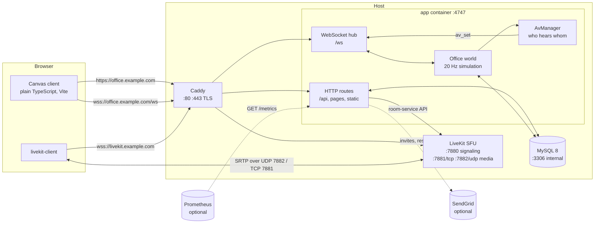

# Arquitetura

O Oficio é um único processo Node.js que serve o cliente do navegador, detém o estado autoritativo do escritório e o envia a todo mundo por WebSocket, ao lado de um banco de dados MySQL para dados duráveis e de um SFU LiveKit para áudio e vídeo. Esta página percorre os componentes e o fluxo de dados, o ciclo de vida de uma requisição HTTP, o protocolo WebSocket, como funcionam os tokens do LiveKit e as inscrições por proximidade, o que é persistido, por que existe exatamente uma réplica do app, a postura de segurança e o layout do repositório.

## Componentes



| Componente | Papel | Onde no repositório |
|---|---|---|
| **Cliente** | Três páginas Vite (`index.html` escritório, `login.html`, `admin.html`) em TypeScript puro, DOM construído com um pequeno helper `h()`, o mapa desenhado em um canvas com pixel art gerada proceduralmente. Fala com o servidor por `fetch` e um WebSocket, e com o LiveKit por meio do `livekit-client`. | `client/` |
| **Camada HTTP** | Guard de requisições, health, config pública, autenticação, perfil, administração, mapa, telemetria, rotas de métricas, gate de páginas, arquivos estáticos (ou middleware do Vite em `--dev`). | `server/http/`, `server/app-factory.ts` |
| **Hub WebSocket** | Aceita upgrades em `/ws`, autentica com o cookie de sessão, aplica heartbeat e rate limits, entrega as mensagens decodificadas ao mundo. | `server/ws/` |
| **Mundo do escritório** | A simulação autoritativa: posições, validação de movimento, assentos, mesas, zonas (salas) com travas e batidas na porta, chat, status, flags de mídia. Roda a 20 Hz, transmite deltas a 10 Hz. | `server/world/` |
| **AvManager** | Calcula, por pessoa, quem é audível e em que volume a partir de posições e zonas, e avisa o cliente (`av_set`). | `server/world/av.ts`, `shared/map/zones.ts` |
| **LiveKit** | SFU WebRTC: cada participante publica mic/câmera/tela uma vez; o SFU encaminha aos inscritos. Container auto-hospedado ou LiveKit Cloud. | `docker-compose.yml`, `deploy/livekit/` |
| **MySQL** | Usuários, tokens, mesas, histórico de chat, mapas, configurações, telemetria. Migrations aplicadas pelo app na inicialização. | `server/db/` |
| **Caddy** | Terminação TLS com certificados automáticos, headers de segurança, proxy reverso para o app e para a sinalização do LiveKit. Substituível por Traefik/nginx; veja [Proxy reverso](reverse-proxy.md). | `docker-compose.yml`, `deploy/caddy/` |
| **Shared** | Código compilado para os dois lados: protocolo WebSocket e validação (zod), modelo/montagem/validação do mapa, dicionários de i18n, helpers de marca. | `shared/` |

## Sequência de inicialização

1. `server/index.ts` carrega a configuração do ambiente (`loadConfig`) e registra todos os avisos (segredos faltando, cor inválida, …).
2. Com `DATABASE_URL`, abre um pool `mysql2` e **executa as migrations pendentes** sob um named lock do MySQL (`GET_LOCK('office_migrate')`), registrando cada uma em `office_migrations`. Sem banco de dados em `--dev`, usa repositórios em memória e cria `dev@oficio.local`.
3. `loadBootMap` lê o **mapa publicado** de `office_maps`. Na primeiríssima inicialização não há nenhum, então o mapa padrão embutido é armazenado como versão #1 e marcado como publicado.
4. `createApp` monta o mapa em uma grade caminhável, inicia o mundo `Office`, anexa o hub WebSocket ao servidor HTTP, conecta as rotas e agenda a limpeza horária da telemetria (retenção de 14 dias).
5. O servidor escuta em `OFFICE_HOST:OFFICE_PORT`. Em `SIGTERM`/`SIGINT` ele fecha o hub, para o mundo, fecha o pool e encerra (limite rígido de 3 s), que é o que o `docker compose stop` espera.

## Ciclo de vida de uma requisição

Toda requisição HTTP passa pelo mesmo pipeline em `app-factory.ts`:

1. **Idioma.** O locale da requisição é resolvido uma vez: `?lang=` → `Accept-Language` → `OFFICE_DEFAULT_LOCALE`. Todas as mensagens de erro a partir daqui são traduzidas com ele.
2. **Guard** (`server/http/guard.ts`).
   - O header `Host` precisa ser um IP literal, `localhost`/`*.localhost`, ou um nome listado em `OFFICE_ALLOWED_HOSTS`; caso contrário `403 Host not allowed`. Isso derrota o DNS rebinding.
   - Para qualquer coisa que não seja `GET`/`HEAD`/`OPTIONS`: quando há um header `Origin` ele precisa bater com o `Host` ou com um nome permitido (`403 Origin not allowed`), e requisições sob `/api/` precisam trazer `Content-Type: application/json` (`415`). Como um formulário cross-site ou um `fetch` "simples" não consegue enviar um content type JSON sem um preflight CORS, e o servidor nunca responde preflights, essa é a defesa contra CSRF. Nenhum token CSRF é necessário.
3. **Endpoints sem autenticação**: `GET /api/health`, `GET /api/config`, `GET /manifest.webmanifest`, `GET /metrics` (bearer token quando `METRICS_TOKEN` está definido).
4. **`/api/*`**: se `OFFICE_JWT_SECRET` está faltando a resposta é `503 authentication not configured`. Caso contrário os handlers de rota rodam em ordem: auth (`/api/auth/*`), perfil (`/api/me*`), telemetria, administração (`/api/admin/*`), mundo (`/api/map`, `/api/livekit/token`), editor de mapa (`/api/admin/maps*`). Caminhos desconhecidos recebem `404`.
5. **Gate de páginas** para `/`, `/index.html`, `/admin` e `/admin/*`: sem sessão válida → `302 /login?next=…`; conta marcada com `must_change_password` → `302 /login?change=1`; `/admin*` para um não administrador → uma pequena página HTML `403`.
6. **Arquivos estáticos** de `dist/client` (produção) ou middleware do Vite (`--dev`). Bundles com hash sob `/bundle/` são servidos com `Cache-Control: immutable` por um ano; todo o resto com `no-cache` + ETag. Caminhos desconhecidos caem em `index.html`; `/login` e `/admin*` mapeiam para suas próprias páginas HTML. Se `dist/client/index.html` não existe, toda página responde `503 Client not built`.

### Sessões

- O login (`POST /api/auth/login`) verifica o hash bcrypt (um hash fictício constante é comparado quando o e-mail não existe, para que o tempo de resposta não revele contas válidas), recusa contas desabilitadas com `403 {code: "disabled"}` e define o cookie **`office_session`**: um JWT (HS256, `OFFICE_JWT_SECRET`) válido por **30 dias**, `HttpOnly`, `Secure` a menos que `OFFICE_COOKIE_SECURE=0`.
- O token carrega o id do usuário e `pv` (versão da senha). Trocar a senha incrementa `pv`, então cookies antigos param de funcionar imediatamente. Ações de administração (desabilitar, rebaixar, redefinir) também removem a entrada do cache de sessões em memória.
- Um pequeno cache LRU (500 entradas, 5 minutos) evita uma leitura no banco a cada requisição; usuários conectados são revalidados periodicamente contra o banco.
- **Rate limits** (em memória, janela deslizante, 10 tentativas por 10 minutos): falhas de login por `IP|email`; pedidos de `forgot` por IP (toda requisição conta); trocas de senha por usuário. Quem é bloqueado recebe `429` com `Retry-After`. O IP do cliente vem de `X-Forwarded-For` somente quando `TRUST_PROXY=1`.
- **Redefinição de senha**: `forgot` cria um token aleatório, armazena somente o seu SHA-256 (`password_tokens`, tipo `reset`, 1 hora, uso único) e envia por e-mail `OFFICE_PUBLIC_URL/login?reset=<token>&lang=<locale>`. Sem mailer o endpoint responde `{ok: true, manual: true}` e a interface orienta a pessoa a procurar um administrador. Senhas precisam ter pelo menos 8 caracteres e ser diferentes do e-mail.

## Protocolo WebSocket

Definido em `shared/protocol.ts`: JSON, um objeto por frame, discriminado pelo campo `t`, validado no servidor com zod (`PROTOCOL_VERSION = 1`). O cliente envia **intenções**; o servidor as valida e é a única fonte da verdade.

**Conexão** (`server/ws/hub.ts`): o upgrade em `/ws` exige um `Origin` que bata com o `Host` ou com `OFFICE_ALLOWED_HOSTS` e um cookie de sessão válido; caso contrário é recusado antes do upgrade. Limites: frames de até 8 KiB, 30 mensagens por segundo por socket (excesso → `error {code: "rate_limited"}` e fechamento 1008), heartbeat a cada 20 s com dois pongs perdidos derrubando a conexão. Uma segunda conexão do mesmo usuário substitui a primeira (`kick {reason: "replaced"}`). O cliente reconecta automaticamente com backoff exponencial (2 s dobrando até 30 s) e ressincroniza a partir do snapshot `welcome`.

**Cliente → servidor**

| Mensagem | Significado |
|---|---|
| `ping {ts}` | sincronização de relógio; respondida por `pong {ts, now}` |
| `move_to {x,y,run?,seq?}` / `move_dir {dir,run?,seq?}` | intenção de caminho ou direção, em tiles |
| `pos {x,y,dir,moving,run?}` | própria posição em pixels do mundo, validada pelo servidor (rejeita com `moved_reject`) |
| `sit {spot}` / `use {spot}` / `stand` | assentos e pontos usáveis (máquina de café, arcade…) |
| `emote {emote}`, `status {status}`, `activity` | emotes, disponível/ocupado/ausente, "ainda estou aqui" (reinicia o auto-ausente) |
| `chat {scope, text}` | `global`, `room` ou `near`; texto limpo e limitado a 1000 caracteres |
| `lock {zone, locked}`, `knock {zone}`, `admit {zone, user, allow}` | portas das salas de reunião |
| `desk_claim {desk}` / `desk_release` | mesas |
| `media {mic, cam, screen, speaking?}` | estado local de A/V mostrado no avatar |

**Servidor → cliente**

| Mensagem | Significado |
|---|---|
| `welcome` | snapshot completo ao conectar: você, tick e relógio, mapa `{id, version, etag}`, entidades, usuários, zonas, mesas, chat recente e `livekit {url, token, room}` (ou `null` quando o LiveKit não está configurado) |
| `state` | ressincronização completa (depois de uma publicação de mapa) |
| `delta {tick, e[]}` | posições a 10 Hz como tuplas compactas `[id, x*16, y*16, dir+pose, flags, held]` |
| `join`, `leave`, `status`, `appearance`, `chat`, `zone`, `desk`, `map`, `knock`, `knock_result`, `media` | eventos incrementais |
| `av_set {hear[], allow[], volumes{}, screenAllowed}` | quem você deve ouvir/ver e em que volume (veja abaixo) |
| `ack {seq,x,y}`, `moved_reject {seq?, reason, x, y}` | reconciliação de movimento |
| `notice`, `kick {reason}`, `error {code}` | manutenção |

## Fluxo de tokens do LiveKit e proximidade

1. O servidor emite os tokens de acesso do LiveKit por conta própria (`server/livekit/tokens.ts`) com `LIVEKIT_API_KEY`/`SECRET`: identidade `u<userId>`, nome de exibição, **TTL de 12 horas**, grant `roomJoin` para a única sala `LIVEKIT_ROOM`, `canPublish` e `canSubscribe` verdadeiros, `canPublishData` falso, fontes publicáveis microfone, câmera, compartilhamento de tela e áudio do compartilhamento de tela. O navegador nunca vê o segredo da API.
2. O token chega na mensagem `welcome` e pode ser renovado com `GET /api/livekit/token` (`503` quando o LiveKit não está configurado).
3. O escritório inteiro é **uma sala LiveKit**. Privacidade e banda vêm das inscrições, não das salas: depois de cada tick em que alguém mudou de tile ou zona, o `AvManager` recalcula o conjunto audível de cada pessoa a partir da geometria do mapa (distância no espaço aberto, mesma zona dentro de uma sala de reunião, paredes bloqueiam o som) e envia `av_set` somente quando ele mudou, no máximo quatro vezes por segundo por pessoa. Ouvir é simétrico: as pessoas que você ouve são exatamente as pessoas que podem ouvir você.
4. O cliente (`client/src/av/subscriptions.ts`) reconcilia a sala com o `av_set`: inscreve-se nas tracks das identidades em `hear` e cancela a inscrição das demais (para que o SFU nunca encaminhe mídia que você não pode ouvir), define o volume de cada participante a partir de `volumes` e chama `setTrackSubscriptionPermissions` com `allow` para que o SFU **se recuse** a entregar suas tracks a qualquer pessoa fora do seu conjunto audível. Tracks de compartilhamento de tela seguem `screenAllowed`.
5. `server/livekit/control.ts` pode, adicionalmente, atualizar as permissões de publicação de um participante pela API room-service do LiveKit (`LIVEKIT_INTERNAL_URL`), com debounce de 400 ms por usuário.

Pacotes de mídia nunca passam pelo servidor do Oficio: eles fluem entre os navegadores e o LiveKit por UDP 7882 (ou TCP 7881 como fallback).

## Persistência

Todas as tabelas são criadas por migrations aditivas em `server/db/migrations/` (`001_init` … `005_telemetry`), rastreadas em `office_migrations`:

| Tabela | Guarda |
|---|---|
| `users` | contas: e-mail, nome, nome de exibição, `password_hash` bcrypt, `password_version`, `must_change_password`, `role_name`, `is_admin`, `status` (`active`/`disabled`), `external_id` (definido para contas importadas), `appearance` e `settings` (JSON), `last_seen_at` |
| `password_tokens` | tokens de redefinição/convite com hash, com expiração e `used_at` |
| `desks` | qual usuário é dono de qual id de mesa, mais `decor` (JSON, migration 004) |
| `chat_messages` | histórico de chat por escopo (`global`/`room`/`near`) e zona |
| `sessions_log` | sessões de login (abertas/fechadas, IP) que alimentam o contador de "logins hoje" |
| `office_maps` | documentos de mapa: o `draft` compartilhado e as `version`s imutáveis com `published_at`, pai, autor e estatísticas |
| `office_settings` | configurações chave/valor, notadamente o id do mapa publicado |
| `telemetry_events` | eventos de diagnóstico do cliente e do servidor, limpos depois de 14 dias |

Todo o resto (posições, quem está em qual sala, travas, batidas pendentes, rate limiters, cache de sessões) vive em memória e é reconstruído a partir do banco e dos clientes que reconectam depois de um restart.

## Por que exatamente uma réplica

O escritório é uma simulação em tempo real: posições, pertencimento a zonas, travas e os conjuntos audíveis de todo mundo online ficam na memória de um processo e avançam 20 vezes por segundo. Duas réplicas acreditariam, cada uma, que são donas do mundo, e uma pessoa conectada à réplica A seria invisível para alguém na réplica B. Os rate limiters em memória e o cache de sessões fazem a mesma suposição. Portanto:

- Rode **um** container `app` (`replicas: 1`, `order: stop-first` na stack Swarm). Escale **para cima** (mais CPU/RAM), não para os lados.
- Restarts e atualizações derrubam todos os WebSockets; os clientes reconectam automaticamente em segundos e recebem um novo `welcome`. Ninguém precisa fazer login de novo: as sessões são cookies.
- MySQL e LiveKit são processos separados e podem viver em outros hosts ou ser serviços gerenciados.
- Compartilhar o estado do mundo via Redis para que várias réplicas cooperem está no [roadmap](roadmap.md), não na 0.1.

## Postura de segurança

- **Container**: usuário não root `node`, sistema de arquivos raiz `read_only` (só `/tmp` como tmpfs de 64 MB), `cap_drop: [ALL]`, `no-new-privileges`, limite de memória, rotação de logs. O app não escreve nada em disco.
- **Borda**: o Caddy adiciona `Strict-Transport-Security`, `X-Content-Type-Options: nosniff`, `X-Frame-Options: DENY`, `Referrer-Policy`. O próprio app também envia `nosniff`, `X-Frame-Options: DENY` e `Referrer-Policy: no-referrer` nas páginas, e `Cross-Origin-Resource-Policy: same-origin` no documento do mapa.
- **Autenticação**: bcrypt (custo 10), JWT de sessão HS256 com invalidação por versão da senha, cookie `HttpOnly`/`Secure`, rate limits de login/forgot/change, comparação em tempo constante para o token de métricas, tokens de redefinição com hash e de uso único.
- **Entrada**: todo frame WebSocket e todo corpo JSON é validado com esquemas zod `strict()` (campos desconhecidos rejeitados); o texto do chat tem os caracteres de controle removidos; tamanhos e taxas de mensagens são limitados.
- **Isolamento**: o MySQL fica somente em uma rede interna; os tokens do LiveKit têm vida curta e são emitidos no servidor; as métricas expõem apenas agregados.
- **Deveres do operador**: `OFFICE_ALLOWED_HOSTS` real, segredos aleatórios, HTTPS em tudo, `LOGIN_MASTER_PASSWORD` vazio, portas 3306/4747/7880 nunca públicas. Veja [SECURITY.md](../../SECURITY.md) para o checklist completo e como reportar uma vulnerabilidade.

## Layout do repositório

```
oficio/
├── client/                 browser app (Vite)
│   ├── index.html, login.html, admin.html
│   ├── public/assets/      pixel art, brand assets, fonts
│   └── src/
│       ├── art/            procedural pixel-art renderers
│       ├── av/             LiveKit integration, devices, proximity subscriptions
│       ├── editor/         map editor (tools, panels, draft store)
│       ├── net/            API client, WebSocket client, world store, branding
│       ├── pages/          login and admin pages, telemetry dashboard
│       ├── ui/             DOM helpers, settings, chat, shell
│       └── world/          office scene, input, camera
├── server/
│   ├── index.ts            entry point (config, migrations, boot map, listen)
│   ├── app-factory.ts      HTTP server, routes, page gate, hub wiring
│   ├── config.ts           environment → ServerConfig (+ warnings)
│   ├── cli.ts, cli-*.ts    CLI: migrate, import-json, create-admin, reset-password
│   ├── auth/               JWT, sessions, passwords, rate limiter, SendGrid mailer
│   ├── db/                 mysql2 pool, migrations, repositories, health
│   ├── http/               guard, routes (auth, me, admin, maps, telemetry, metrics), static
│   ├── import/             user import (JSON reader + pure core)
│   ├── livekit/            token minting, room-service control
│   ├── telemetry/          server sink and batch validation
│   ├── world/              Office simulation, AV manager, boot/fallback maps
│   └── ws/                 WebSocket hub and outbox
├── shared/                 protocol, model, map (doc, assembly, validation, default map), i18n, branding
├── deploy/                 Caddyfile, nginx conf, LiveKit yaml, Portainer stacks (standalone, Swarm+Traefik)
├── scripts/                gen-secrets, first-admin, backup/restore, brand asset generator, QA probes
├── docs/                   this documentation (+ docs/pt-BR mirror)
├── docker-compose.yml      production stack (app + MySQL + LiveKit + Caddy)
├── docker-compose.dev.yml  local MySQL + LiveKit for `npm run dev`
├── docker-compose.build.yml override to build the image from the checkout
└── Dockerfile              two-stage build, production deps only
```

Build: `npm run build` roda o Vite para o cliente (`dist/client`) e o esbuild para o servidor (`dist/server`, com as migrations embutidas). Testes: Vitest, ao lado do código (`*.test.ts`). A checagem de tipos cobre tanto o `tsconfig.json` (client/shared) quanto o `server/tsconfig.json`.
