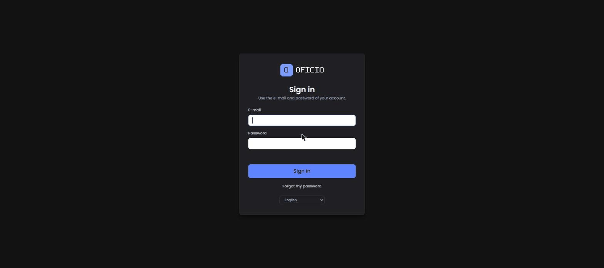
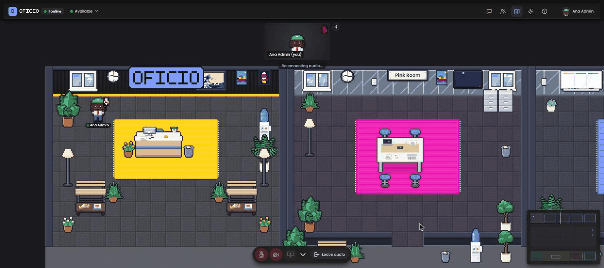
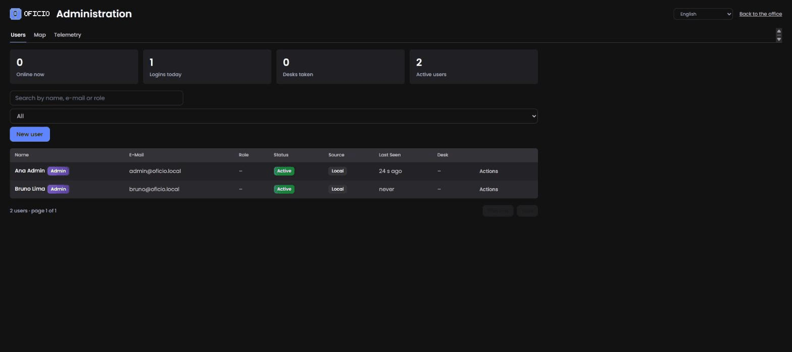

# Início rápido

De um VPS Linux vazio a um escritório funcionando em cerca de dez minutos: instale o Docker, aponte dois nomes DNS para o servidor, gere os segredos, inicie a stack com o `docker-compose.yml`, crie o primeiro administrador e convide um colega. Cada passo mostra o comando e o que você deve ver. Se algo for diferente, pule para [Solução de problemas](troubleshooting.md).

Antes de começar, confira se você atende aos [requisitos](requirements.md): um host com IP público, Docker 24+ com Compose v2.23+, dois registros A (`office.example.com` e `livekit.example.com`) apontando para ele e as portas 80/tcp, 443/tcp, 7881/tcp e 7882/udp abertas. Substitua `example.com` pelo seu próprio domínio em todo o texto.

## 1. Instale o Docker

No Ubuntu ou Debian:

```sh
curl -fsSL https://get.docker.com | sh
sudo usermod -aG docker "$USER"   # log out and back in afterwards
docker compose version
```

Esperado: uma linha como `Docker Compose version v2.29.x`. Qualquer versão 2.23 ou mais nova serve.

Abra o firewall se o host tiver um:

```sh
sudo ufw allow 22/tcp && sudo ufw allow 80/tcp && sudo ufw allow 443/tcp
sudo ufw allow 7881/tcp && sudo ufw allow 7882/udp
sudo ufw enable
```

## 2. Verifique o DNS

```sh
dig +short office.example.com
dig +short livekit.example.com
curl -4 -s ifconfig.me
```

Os dois primeiros comandos devem imprimir o mesmo IP que o terceiro imprime. Se você usa Cloudflare, os dois registros devem estar como **DNS only** (nuvem cinza). Anote o IP: ele vai em `LIVEKIT_NODE_IP`.

## 3. Baixe o código e gere os segredos

```sh
sudo mkdir -p /opt/oficio && sudo chown "$USER" /opt/oficio
git clone https://github.com/thiagomorello/oficio.git /opt/oficio
cd /opt/oficio
cp .env.example .env
./scripts/gen-secrets.sh
```

Saída esperada:

```
set OFFICE_JWT_SECRET
set MYSQL_ROOT_PASSWORD
set MYSQL_PASSWORD
set LIVEKIT_API_KEY
set LIVEKIT_API_SECRET
set METRICS_TOKEN

Done. Now edit .env and set: OFFICE_DOMAIN, LIVEKIT_DOMAIN, ACME_EMAIL, OFFICE_PUBLIC_URL, OFFICE_ALLOWED_HOSTS, LIVEKIT_URL (and LIVEKIT_NODE_IP if you know the public IP).
```

O script pode ser executado de novo com segurança: valores já definidos são mantidos. Ele também reescreve `DATABASE_URL` para bater com `MYSQL_PASSWORD` e deixa o `.env` com modo 600.

> **Windows (só para testes locais).** `.\scripts\gen-secrets.ps1` faz o mesmo trabalho em PowerShell. Produção deve rodar em Linux; o arquivo compose publica portas UDP e depende de o Caddy obter certificados nas portas 80/443, o que é complicado em uma máquina desktop.

## 4. Edite o `.env`

```sh
nano .env
```

Defina estas linhas (todo o resto pode ficar como foi gerado):

```ini
OFFICE_DOMAIN=office.example.com
LIVEKIT_DOMAIN=livekit.example.com
ACME_EMAIL=you@example.com

OFFICE_PUBLIC_URL=https://office.example.com
OFFICE_ALLOWED_HOSTS=office.example.com
LIVEKIT_URL=wss://livekit.example.com
LIVEKIT_NODE_IP=203.0.113.10        # the public IP from step 2
```

`OFFICE_PUBLIC_URL`, `OFFICE_ALLOWED_HOSTS` e `LIVEKIT_URL` são derivados dos dois domínios pelo `docker-compose.yml` quando estão **ausentes**, mas o `.env.example` vem com eles preenchidos com `example.com`, então ou defina-os ou apague essas três linhas. Opcional, mas recomendado neste ponto: `OFFICE_APP_NAME=Sua Empresa` e `TZ=America/Sao_Paulo` (ou o seu fuso). A lista completa está em [Configuração](configuration.md).

## 5. Inicie a stack

```sh
docker compose up -d
docker compose ps
```

Depois de 30–60 segundos (o MySQL inicializa na primeira vez) todos os serviços devem estar `running` e `app`, `livekit` e `mysql` devem estar `(healthy)`:

```
NAME             IMAGE                                  STATUS
oficio-app-1     ghcr.io/thiagomorello/oficio:latest    Up 40 seconds (healthy)
oficio-caddy-1   caddy:2-alpine                         Up 55 seconds
oficio-livekit-1 livekit/livekit-server:v1.13.11        Up 55 seconds (healthy)
oficio-mysql-1   mysql:8.0                              Up 55 seconds (healthy)
```

Acompanhe a emissão dos certificados e a inicialização do app:

```sh
docker compose logs -f caddy app
```

O Caddy registra `certificate obtained successfully` para cada domínio. O app registra seus avisos (não deve haver nenhum sobre segredos faltando), as migrations que aplicou (`migration 001_init...` … `005_telemetry`), `First boot: default map stored as published version #1` e, por fim, `Oficio 0.1.1 (docker) listening on http://0.0.0.0:4747`. Pressione `Ctrl+C` para parar de acompanhar.

Agora confira de fora:

```sh
curl -s https://office.example.com/api/health
curl -s https://livekit.example.com/
```

Esperado:

```json
{"ok":true,"db":"ok","version":"0.1.1","uptime":42,"online":0,"livekit":true}
```

e um simples `OK` do LiveKit. Se o `curl` reclamar do certificado, o Caddy ainda não terminou a troca ACME; espere um minuto e tente de novo. Se continuar falhando, veja [Solução de problemas](troubleshooting.md#o-caddy-não-consegue-obter-um-certificado).

## 6. Crie o primeiro administrador

```sh
./scripts/first-admin.sh you@example.com "Your Name"
```

O script roda `create-admin` dentro do container `app`. Ele imprime uma confirmação e uma **senha temporária, mostrada só uma vez**. Copie-a. A conta precisa trocar essa senha no primeiro login.

Se preferir escolher a senha você mesmo (mínimo de 8 caracteres):

```sh
./scripts/first-admin.sh you@example.com "Your Name" 'a-long-password-here'
```

Rodar o script para um e-mail que já existe simplesmente promove essa conta a administrador sem mexer na senha.

## 7. Primeiro login

Abra `https://office.example.com`. Você é redirecionado para `/login`.



1. Informe seu e-mail e a senha temporária.
2. Você é solicitado a definir uma nova senha (pelo menos 8 caracteres, diferente do seu e-mail).
3. O editor de avatar abre: escolha cabelo, pele, roupa, acessórios e um nome de exibição, ou use o aleatorizador. Salve.
4. Você está na recepção do escritório padrão. Mova-se com as setas ou WASD, ou clique onde quer ir. Shift faz você correr.



Clique no botão de microfone na barra inferior e permita o acesso quando o navegador pedir. O botão ficar ativo significa que o navegador alcançou o LiveKit. Se ele não fizer nada, você não está em HTTPS; se funcionar mas depois ninguém conseguir ouvir ninguém, o UDP provavelmente está bloqueado (veja [Solução de problemas](troubleshooting.md#as-pessoas-não-se-ouvem-nem-se-veem-mas-o-chat-funciona)).

## 8. Convide um colega

Abra `https://office.example.com/admin` (o link de engrenagem/administração na barra superior, ou digite a URL).



1. Em **Usuários**, clique em **Convidar** (novo usuário).
2. Preencha nome, e-mail e, opcionalmente, um rótulo de função; marque **Administrador** se a pessoa também deve gerenciar o escritório.
3. Salve. Sem o SendGrid configurado, o diálogo mostra uma **senha temporária**; envie-a à pessoa por um canal em que você confie. Com `SENDGRID_API_KEY` e `MAIL_FROM` definidos, um e-mail de convite é enviado em vez disso.

Peça que a pessoa abra o escritório em outro navegador enquanto você está nele. Aproximem-se um do outro: o áudio conecta quando vocês estão perto, e o volume diminui com a distância. Entrem juntos em uma sala de reunião para conversar em privado e compartilhar a tela.

## 9. Deixe com a sua cara

- **Nome, logo, cor, placa da recepção:** `OFFICE_APP_NAME`, `OFFICE_LOGO_URL`, `OFFICE_ACCENT_COLOR`, `OFFICE_SIGN_TEXT` no `.env`, depois `docker compose up -d` para aplicar. Veja [Configuração → Marca](configuration.md#marca-whitelabel).
- **Idioma:** `OFFICE_DEFAULT_LOCALE=en`, `pt-BR` ou `es`. Cada pessoa pode sobrescrever nas próprias configurações. Veja [i18n](i18n.md).
- **Planta:** `https://office.example.com/admin/mapa` abre o editor de mapa. Desenhe pisos, paredes, salas e mesas, valide, publique. Veja [Guia do administrador → Editor de mapa](admin-guide.md#editor-de-mapa).
- **E-mails:** adicione `SENDGRID_API_KEY` e `MAIL_FROM` para que convites e redefinições de senha saiam automaticamente.

## 10. Antes que você esqueça

- **Backups:** `./scripts/backup.sh` faz o dump do MySQL em `./backups/`. Coloque no cron; veja [Backup e restauração](backup-restore.md).
- **Atualizações:** fixe `OFICIO_VERSION=0.1.1` no `.env` quando estiver satisfeito, e leia [Atualização](upgrading.md) antes de mudar.
- **Monitoramento:** `GET /api/health` para checagens de disponibilidade; `GET /metrics` com `Authorization: Bearer $METRICS_TOKEN` para o Prometheus.
- **Hardening:** passe os olhos no checklist em [SECURITY.md](../../SECURITY.md).

Para onde ir em seguida: [Guia do administrador](admin-guide.md) para a operação do dia a dia, [Arquitetura](architecture.md) para entender o que você acabou de implantar, e os guias específicos por plataforma em `deploy/` se você não está em um VPS comum.
