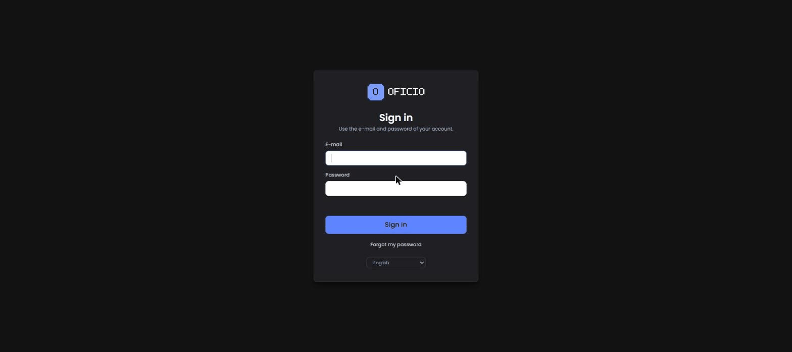
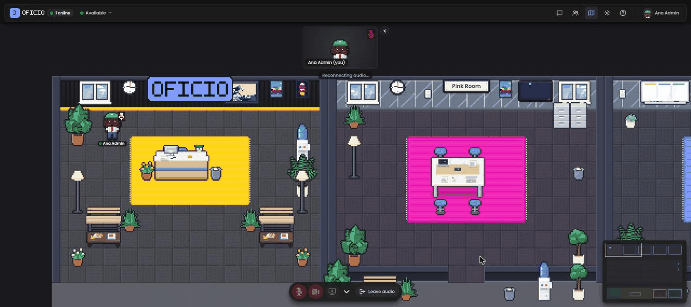
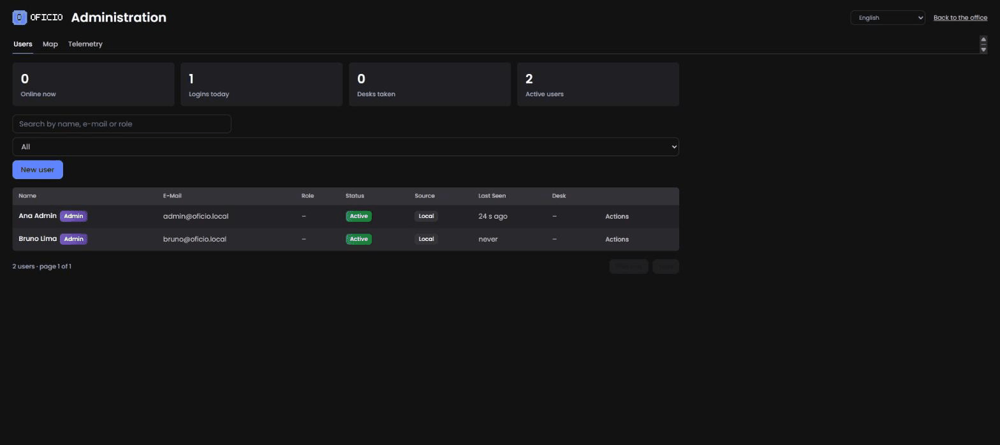

# Quickstart

From an empty Linux VPS to a working office in about ten minutes: install Docker, point two DNS names at the server, generate secrets, start the stack with `docker-compose.yml`, create the first administrator and invite a colleague. Every step shows the command and what you should see. If anything differs, jump to [Troubleshooting](troubleshooting.md).

Before you start, make sure you meet the [requirements](requirements.md): a host with a public IP, Docker 24+ with Compose v2.23+, two A records (`office.example.com` and `livekit.example.com`) pointing at it, and ports 80/tcp, 443/tcp, 7881/tcp and 7882/udp open. Replace `example.com` with your own domain throughout.

## 1. Install Docker

On Ubuntu or Debian:

```sh
curl -fsSL https://get.docker.com | sh
sudo usermod -aG docker "$USER"   # log out and back in afterwards
docker compose version
```

Expected: a line such as `Docker Compose version v2.29.x`. Anything 2.23 or newer is fine.

Open the firewall if the host has one:

```sh
sudo ufw allow 22/tcp && sudo ufw allow 80/tcp && sudo ufw allow 443/tcp
sudo ufw allow 7881/tcp && sudo ufw allow 7882/udp
sudo ufw enable
```

## 2. Check DNS

```sh
dig +short office.example.com
dig +short livekit.example.com
curl -4 -s ifconfig.me
```

The first two commands must print the same IP the third one prints. If you use Cloudflare, both records must be **DNS only** (grey cloud). Write the IP down: it goes into `LIVEKIT_NODE_IP`.

## 3. Get the code and generate secrets

```sh
sudo mkdir -p /opt/oficio && sudo chown "$USER" /opt/oficio
git clone https://github.com/thiagomorello/oficio.git /opt/oficio
cd /opt/oficio
cp .env.example .env
./scripts/gen-secrets.sh
```

Expected output:

```
set OFFICE_JWT_SECRET
set MYSQL_ROOT_PASSWORD
set MYSQL_PASSWORD
set LIVEKIT_API_KEY
set LIVEKIT_API_SECRET
set METRICS_TOKEN

Done. Now edit .env and set: OFFICE_DOMAIN, LIVEKIT_DOMAIN, ACME_EMAIL, OFFICE_PUBLIC_URL, OFFICE_ALLOWED_HOSTS, LIVEKIT_URL (and LIVEKIT_NODE_IP if you know the public IP).
```

The script is safe to re-run: values that are already set are kept. It also rewrites `DATABASE_URL` so it matches `MYSQL_PASSWORD`, and sets `.env` to mode 600.

> **Windows (local tests only).** `.\scripts\gen-secrets.ps1` does the same job in PowerShell. Production should run on Linux; the compose file publishes UDP ports and relies on Caddy getting certificates on 80/443, which is awkward on a desktop machine.

## 4. Edit `.env`

```sh
nano .env
```

Set these lines (everything else can stay as generated):

```ini
OFFICE_DOMAIN=office.example.com
LIVEKIT_DOMAIN=livekit.example.com
ACME_EMAIL=you@example.com

OFFICE_PUBLIC_URL=https://office.example.com
OFFICE_ALLOWED_HOSTS=office.example.com
LIVEKIT_URL=wss://livekit.example.com
LIVEKIT_NODE_IP=203.0.113.10        # the public IP from step 2
```

`OFFICE_PUBLIC_URL`, `OFFICE_ALLOWED_HOSTS` and `LIVEKIT_URL` are derived from the two domains by `docker-compose.yml` when they are **absent**, but `.env.example` ships them filled with `example.com`, so either set them or delete those three lines. Optional but recommended at this point: `OFFICE_APP_NAME=Your Company` and `TZ=America/Sao_Paulo` (or your zone). The full list is in [Configuration](configuration.md).

## 5. Start the stack

```sh
docker compose up -d
docker compose ps
```

After 30–60 seconds (MySQL initialises on first boot) every service should be `running` and `app`, `livekit` and `mysql` should be `(healthy)`:

```
NAME             IMAGE                                  STATUS
oficio-app-1     ghcr.io/thiagomorello/oficio:latest    Up 40 seconds (healthy)
oficio-caddy-1   caddy:2-alpine                         Up 55 seconds
oficio-livekit-1 livekit/livekit-server:v1.13.11        Up 55 seconds (healthy)
oficio-mysql-1   mysql:8.0                              Up 55 seconds (healthy)
```

Watch the certificates being issued and the app booting:

```sh
docker compose logs -f caddy app
```

Caddy logs `certificate obtained successfully` for each domain. The app logs its warnings (there should be none about missing secrets), the migrations it applied (`migration 001_init...` … `005_telemetry`), `First boot: default map stored as published version #1` and finally `Oficio 0.1.1 (docker) listening on http://0.0.0.0:4747`. Press `Ctrl+C` to stop following.

Now check from outside:

```sh
curl -s https://office.example.com/api/health
curl -s https://livekit.example.com/
```

Expected:

```json
{"ok":true,"db":"ok","version":"0.1.1","uptime":42,"online":0,"livekit":true}
```

and a bare `OK` from LiveKit. If `curl` complains about the certificate, Caddy has not finished the ACME exchange yet; wait a minute and retry. If it keeps failing, see [Troubleshooting](troubleshooting.md#caddy-cannot-get-a-certificate).

## 6. Create the first administrator

```sh
./scripts/first-admin.sh you@example.com "Your Name"
```

The script runs `create-admin` inside the `app` container. It prints a confirmation and a **temporary password, shown only once**. Copy it. The account must change that password at first login.

If you would rather choose the password yourself (minimum 8 characters):

```sh
./scripts/first-admin.sh you@example.com "Your Name" 'a-long-password-here'
```

Running the script for an e-mail that already exists simply promotes that account to admin without touching its password.

## 7. First login

Open `https://office.example.com`. You are redirected to `/login`.



1. Enter your e-mail and the temporary password.
2. You are asked to set a new password (at least 8 characters, different from your e-mail).
3. The avatar editor opens: pick hair, skin, outfit, accessories and a display name, or hit the randomizer. Save.
4. You are standing in the lobby of the default office. Move with the arrow keys or WASD, or click where you want to go. Shift makes you run.



Click the microphone button in the bottom bar and allow access when the browser asks. The button turning active means the browser reached LiveKit. If it does nothing, you are not on HTTPS; if it works but nobody can hear anybody later, UDP is probably blocked (see [Troubleshooting](troubleshooting.md#people-cannot-hear-or-see-each-other-but-chat-works)).

## 8. Invite a colleague

Open `https://office.example.com/admin` (the gear/admin link in the top bar, or type the URL).



1. In **Users**, click **Invite** (new user).
2. Fill in name, e-mail and optionally a role label; tick **Administrator** if they should manage the office too.
3. Save. Without SendGrid configured, the dialog shows a **temporary password**; send it to the person through a channel you trust. With `SENDGRID_API_KEY` and `MAIL_FROM` set, an invitation e-mail is sent instead.

Ask them to open the office in another browser while you are in it. Walk up to each other: the audio connects when you are close, and the volume fades with distance. Enter a meeting room together to talk privately and share a screen.

## 9. Make it yours

- **Name, logo, color, lobby sign:** `OFFICE_APP_NAME`, `OFFICE_LOGO_URL`, `OFFICE_ACCENT_COLOR`, `OFFICE_SIGN_TEXT` in `.env`, then `docker compose up -d` to apply. See [Configuration → Branding](configuration.md#branding-whitelabel).
- **Language:** `OFFICE_DEFAULT_LOCALE=en`, `pt-BR` or `es`. Each person can override it in their settings. See [i18n](i18n.md).
- **Floor plan:** `https://office.example.com/admin/mapa` opens the map editor. Draw floors, walls, rooms and desks, validate, publish. See [Admin guide → Map editor](admin-guide.md#map-editor).
- **E-mails:** add `SENDGRID_API_KEY` and `MAIL_FROM` so invitations and password resets go out automatically.

## 10. Before you forget

- **Backups:** `./scripts/backup.sh` dumps MySQL to `./backups/`. Put it in cron; see [Backup and restore](backup-restore.md).
- **Upgrades:** pin `OFICIO_VERSION=0.1.1` in `.env` once you are happy, and read [Upgrading](upgrading.md) before changing it.
- **Monitoring:** `GET /api/health` for uptime checks; `GET /metrics` with `Authorization: Bearer $METRICS_TOKEN` for Prometheus.
- **Hardening:** skim the checklist in [SECURITY.md](../SECURITY.md).

Where to go next: [Admin guide](admin-guide.md) for day-to-day operation, [Architecture](architecture.md) to understand what you just deployed, and the platform-specific guides under `deploy/` if you are not on a plain VPS.
